# Mantenimiento IPF

App para que alumnos y docentes del Instituto Politécnico Formosa reporten desperfectos del
edificio, una luz quemada o una canilla que pierde, y se enteren cuando se resuelven.

Es la **Parte G** del Trabajo Práctico N° 3 de Taller Complementario – React Native II. Las
Partes A a F están en **[RESPUESTAS.md](./RESPUESTAS.md)**.

El tema real del trabajo no es el formulario de reportes, es cómo se piden los permisos. La app
usa cámara, ubicación y notificaciones, elige fotos sin pedir permiso de galería, y ninguna
función queda bloqueada si la persona dice que no.

---

## Cómo correrlo

```bash
npm install
npx expo start
```

| Comando | Qué hace |
| --- | --- |
| `npx expo start` | Servidor de desarrollo, para Expo Go o development build. |
| `npx expo prebuild --clean` | Genera `android/` e `ios/` desde `app.json`. Sirve para auditar el manifiesto. |
| `npx expo run:android` | Compila y corre una development build de Android. |
| `eas build --profile development --platform android` | La misma build, en la nube. |
| `npx tsc --noEmit` | Chequeo de tipos. |

Qué se puede probar en cada entorno:

| | Expo Go | Development build |
| --- | --- | --- |
| Los cuatro estados, pantallas previas, alternativas | ✅ | ✅ |
| Volver de Ajustes y que el panel se actualice | ✅ | ✅ |
| Los textos de propósito propios en el diálogo | ❌ aparecen los de Expo Go | ✅ |
| El manifiesto real y `blockedPermissions` | ❌ | ✅ |
| Notificaciones locales programadas | ✅ con un warning en consola | ✅ |
| Push remotas en Android | ❌ desde SDK 53 | ✅ |

El entorno es Expo SDK 57 con React Native 0.86 y Expo Router 57, apuntando a Android API 36 con
`minSdk` 24, y a iOS 16.4.

---

## Árbol de rutas

```
src/app/
├── _layout.tsx                 Stack raíz · store + el modal de la previa
├── (tabs)/
│   ├── _layout.tsx             Las tres solapas
│   ├── index.tsx               /            Inicio: mis reportes + "Nuevo reporte"
│   ├── avisos.tsx              /avisos      Bandeja, la alternativa a las notificaciones
│   └── permisos.tsx            /permisos    Panel con el estado de cada permiso
├── reporte/
│   ├── nuevo.tsx               /reporte/nuevo       Formulario, sin pedir nada al abrir
│   ├── escanear.tsx            /reporte/escanear    Cámara, con los cuatro estados
│   ├── foto.tsx                /reporte/foto        Sacar foto o elegir del selector
│   ├── ubicacion.tsx           /reporte/ubicacion   Ubicación en primer plano
│   └── [id].tsx                /reporte/[id]        Detalle + "Simular resolución"
├── permisos/
│   └── [recurso].tsx           /permisos/[recurso]  La pantalla previa, como modal
├── ajustes-app.tsx             /ajustes-app         Interruptor de avisos
└── +not-found.tsx              404
```

`/permisos` es una solapa y `/permisos/[recurso]` es un modal del stack raíz. Son rutas
distintas, así que no chocan, y de esa forma la previa se abre encima de cualquier pantalla sin
sacar a la persona de lo que estaba haciendo. `(tabs)` es un grupo, o sea que no aparece en la
URL: la solapa de inicio responde a `/` y no a `/tabs`.

El resto del código:

```
src/
├── components/
│   ├── pantalla-previa.tsx     La previa. El único lugar que llama a pedir()
│   ├── aviso-permiso.tsx       Tarjeta que se muestra cuando falta un permiso
│   ├── estado-reporte.tsx      Chip de estado del reporte
│   └── ui.tsx                  Botones, tarjetas, campos, chips
├── hooks/
│   ├── usePermiso.ts           Cuatro estados, matiz, pedir() y abrirAjustes()
│   └── useRevisarAlVolver.ts   AppState: volver a consultar al regresar de Ajustes
└── lib/
    ├── permisos.ts             Catálogo: textos, alternativas, rutas de Ajustes
    ├── notificaciones.ts       Canal de Android, pedido, provisional, aviso a los 10 s
    ├── ubicacion.ts            obtenerUbicacion, esAproximada, describirUbicacion
    ├── store.tsx               Reportes, avisos y borrador
    └── tema.ts                 Colores y medidas
```

---

## El bloque `plugins` de `app.json`

```jsonc
"plugins": [
  "expo-router",
  ["expo-splash-screen", { /* … */ }],

  [
    "expo-camera",
    {
      // Texto propio, con el molde "Usamos tu [dato] para [beneficio concreto]".
      "cameraPermission": "Usamos la cámara para leer el QR pegado en la puerta del aula y para sacar la foto del desperfecto que estás reportando.",

      // MÍNIMO PRIVILEGIO · la app lee QR y saca fotos, nunca graba audio.
      // false omite NSMicrophoneUsageDescription del Info.plist…
      "microphonePermission": false,
      // …y saca RECORD_AUDIO del manifiesto con tools:node="remove".
      "recordAudioAndroid": false
    }
  ],

  [
    "expo-location",
    {
      // La única clave de ubicación que se escribe es la de primer plano.
      "locationWhenInUsePermission": "Usamos tu ubicación para marcar en qué sector del Instituto está el desperfecto que estás reportando.",

      // MÍNIMO PRIVILEGIO · marcar un desperfecto se hace con la app abierta.
      // Nunca pedimos "Siempre", así que estas tres claves quedan fuera…
      "locationAlwaysAndWhenInUsePermission": false,
      "locationAlwaysPermission": false,
      "motionUsagePermission": false,
      // …y en Android no se declara ACCESS_BACKGROUND_LOCATION ni el foreground service.
      "isIosBackgroundLocationEnabled": false,
      "isAndroidBackgroundLocationEnabled": false,
      "isAndroidForegroundServiceEnabled": false
    }
  ],

  [
    "expo-image-picker",
    {
      // false → no se escribe NSPhotoLibraryUsageDescription.
      // Elegir una foto usa el selector del sistema, que no necesita permiso.
      "photosPermission": false,

      // Acá sí va texto, porque launchCameraAsync usa la cámara.
      // Tiene que ser el mismo que el de expo-camera: los dos plugins escriben
      // la misma clave del Info.plist y gana el último.
      // Ojo, poner false acá bloquearía android.permission.CAMERA, que sí usamos.
      "cameraPermission": "Usamos la cámara para leer el QR pegado en la puerta del aula y para sacar la foto del desperfecto que estás reportando.",
      "microphonePermission": false
    }
  ],

  [
    "expo-notifications",
    {
      "color": "#1D4ED8",
      // El canal de Android que la app crea antes de pedir el permiso.
      "defaultChannel": "reportes"
    }
  ]
],

"android": {
  // Cada uno se justifica en la tabla de abajo.
  "blockedPermissions": [
    "android.permission.RECORD_AUDIO",
    "android.permission.SYSTEM_ALERT_WINDOW",
    "android.permission.ACCESS_BACKGROUND_LOCATION",
    "android.permission.READ_MEDIA_IMAGES",
    "android.permission.READ_MEDIA_VIDEO",
    "android.permission.READ_MEDIA_VISUAL_USER_SELECTED"
  ]
}
```

---

## Tabla de permisos

| Recurso | Módulo | ¿Cuándo se pide? | Alternativa si se deniega |
| --- | --- | --- | --- |
| Cámara, para escanear | `expo-camera` · `useCameraPermissions()` | Al entrar a `/reporte/escanear`, o sea después de tocar "Escanear el QR del aula". Nunca al abrir la app ni el formulario. | Escribir el código del aula a mano, en la misma pantalla. |
| Cámara, para sacar la foto | `expo-image-picker` · `launchCameraAsync()`, sobre el mismo permiso | Al tocar "Abrir la cámara" en `/reporte/foto`. | Elegir una foto con el selector del sistema, o cargar el reporte sin foto. |
| Galería | `expo-image-picker` · `launchImageLibraryAsync()` | **Nunca.** El selector corre fuera de la app y devuelve sólo la imagen elegida. | — |
| Ubicación en primer plano | `expo-location` · `useForegroundPermissions()` | Al tocar "Marcar dónde estoy" en `/reporte/ubicacion`. | Elegir el sector a mano. |
| Notificaciones | `expo-notifications` · `requestPermissionsAsync()` | Sólo al activar el interruptor en `/ajustes-app`. | Los mismos avisos quedan en `/avisos`. |

### Los `blockedPermissions`, uno por uno

| Permiso bloqueado | Quién lo agregaba | Por qué lo saco |
| --- | --- | --- |
| `RECORD_AUDIO` | `expo-camera` y `expo-image-picker`, porque sus módulos pueden grabar video con audio. | La app lee QR y saca fotos fijas, nunca graba sonido. Dejarlo mostraría Micrófono en la ficha de Play. |
| `SYSTEM_ALERT_WINDOW` | Ninguna librería de este proyecto, está por pedido de la consigna. | Es un permiso especial para dibujar sobre otras apps. La app no tiene nada que superponer, y bloquearlo evita que alguna dependencia futura lo cuele. |
| `ACCESS_BACKGROUND_LOCATION` | `expo-location`, si se activara `isAndroidBackgroundLocationEnabled`. | La ubicación se lee una vez, con la app abierta. Pedir segundo plano obligaría además a una revisión manual de Google Play. |
| `READ_MEDIA_IMAGES`, `READ_MEDIA_VIDEO` y `READ_MEDIA_VISUAL_USER_SELECTED` | Nadie los declara hoy, pero son los permisos de galería de Android 13 y 14. | La app usa el photo picker. Bloquearlos deja por escrito que no queremos acceso a la fototeca, aunque mañana se agregue una librería que lo pida. |

Lo que **sí** dejo son `READ_EXTERNAL_STORAGE` y `WRITE_EXTERNAL_STORAGE` con
`android:maxSdkVersion="32"`, que vienen del manifiesto de `expo-image-picker`. Están acotados a
Android 12 y anteriores, donde el selector de fotos moderno no existe y el módulo los necesita
para devolver la imagen elegida. En Android 13+ Android directamente no los instala, así que
bloquearlos rompería la función en los teléfonos viejos a cambio de nada.

---

## Auditoría del manifiesto

Salida real de `npx expo prebuild --clean`, leyendo `android/app/src/main/AndroidManifest.xml`:

| Permiso en el manifiesto generado | Quién lo agrega | ¿Lo saco? |
| --- | --- | --- |
| `INTERNET` | Expo y React Native, de base | No. Es de instalación y lo necesita el bundler en desarrollo. |
| `CAMERA` | `expo-camera` y `expo-image-picker` | No, es el permiso central de la app. |
| `ACCESS_COARSE_LOCATION` | `expo-location` | No. Es la mitad aproximada del permiso de ubicación. |
| `ACCESS_FINE_LOCATION` | `expo-location` | No. Las dos van juntas en un solo diálogo. |
| `VIBRATE` | `expo-notifications` | No. Es de instalación, sin diálogo, y es lo que hace que el aviso se sienta. |
| `READ_EXTERNAL_STORAGE` hasta API 32 | `expo-image-picker` | No, ver arriba. |
| `WRITE_EXTERNAL_STORAGE` hasta API 32 | `expo-image-picker` | No, ver arriba. |
| `RECORD_AUDIO` | `expo-camera` y `expo-image-picker` | **Sí**, con `tools:node="remove"`. |
| `SYSTEM_ALERT_WINDOW` | Preventivo | **Sí**, con `tools:node="remove"`. |
| `ACCESS_BACKGROUND_LOCATION` | Preventivo | **Sí**, con `tools:node="remove"`. |
| `READ_MEDIA_IMAGES`, `READ_MEDIA_VIDEO`, `READ_MEDIA_VISUAL_USER_SELECTED` | Preventivo | **Sí**, con `tools:node="remove"`. |

Un dato que vale la pena anotar: `POST_NOTIFICATIONS` y `RECEIVE_BOOT_COMPLETED` **no aparecen**
en ese archivo y sin embargo están en el APK. Los declara `expo-notifications` en el manifiesto
de la librería, y el manifest merger de Gradle los fusiona recién al compilar. O sea que el
manifiesto generado por `prebuild` no es la lista completa de permisos de la app. Para ver la
lista final hay que mirar el APK con `aapt dump permissions`, o el manifiesto fusionado que deja
Gradle en `android/app/build/intermediates/merged_manifests/`.

El `Info.plist` generado, en cambio, queda con exactamente dos claves de propósito:

```xml
<key>NSCameraUsageDescription</key>
<string>Usamos la cámara para leer el QR pegado en la puerta del aula y para sacar la foto del desperfecto que estás reportando.</string>
<key>NSLocationWhenInUseUsageDescription</key>
<string>Usamos tu ubicación para marcar en qué sector del Instituto está el desperfecto que estás reportando.</string>
```

Sin micrófono, sin fototeca y sin ubicación siempre.

---

## Cómo está resuelto cada requisito

### 1 · El hook unificado

[`src/hooks/usePermiso.ts`](./src/hooks/usePermiso.ts)

```ts
const { estado, parcial, pedir, abrirAjustes, consultar, respuesta, ficha } = usePermiso('camara');
// estado: 'cargando' | 'concedido' | 'preguntable' | 'bloqueado'
```

Los cuatro estados salen de dos campos de la respuesta de Expo:

```ts
if (!respuesta) return 'cargando';          // primer render, todavía no sabemos nada
if (respuesta.granted) return 'concedido';
return respuesta.canAskAgain ? 'preguntable' : 'bloqueado';
```

Por dentro usa los hooks oficiales de cada módulo, `useCameraPermissions` y
`Location.useForegroundPermissions`, y para notificaciones, que no tiene hook propio,
`getPermissionsAsync()` con estado local. Cada instancia consulta sólo su recurso gracias a
`{ get: recurso === 'camara' }`.

Se refresca solo en dos momentos. `useFocusEffect` lo actualiza al volver de la pantalla previa
o de otra pantalla, y `useRevisarAlVolver`, que escucha `AppState`, al volver de Ajustes.

`parcial` devuelve el matiz cuando el permiso está concedido a medias: `'Ubicación aproximada'`
si `android.accuracy` es `'coarse'` o `ios.accuracy` es `'reduced'`, y
`'Avisos provisionales'` si `ios.status` es `PROVISIONAL`.

### 2 · Escáner con cuatro estados

[`src/app/reporte/escanear.tsx`](./src/app/reporte/escanear.tsx)

Cargando muestra el indicador, concedido muestra la `CameraView`, y preguntable y bloqueado
muestran la tarjeta que lleva a la previa. En los cuatro, el campo para escribir el código a
mano está disponible.

### 3 · Foto sin permiso de galería

[`src/app/reporte/foto.tsx`](./src/app/reporte/foto.tsx)

"Elegir de la galería" llama a `ImagePicker.launchImageLibraryAsync()` y no consulta ningún
permiso. La app no declara `READ_MEDIA_IMAGES` ni `NSPhotoLibraryUsageDescription`.

### 4 · Ubicación respetuosa

[`src/app/reporte/ubicacion.tsx`](./src/app/reporte/ubicacion.tsx)

Sólo primer plano. Si el permiso es aproximado, la app guarda y muestra "Ubicación aproximada"
en lugar de coordenadas, porque con 3 km² de margen el número daría una precisión que no existe.
Si se deniega, el reporte se carga con el sector elegido a mano.

### 5 · Notificaciones en contexto

[`src/app/ajustes-app.tsx`](./src/app/ajustes-app.tsx)

El permiso se pide únicamente al activar el interruptor. En Android, `prepararCanalAndroid()`
crea el canal `"reportes"` antes de pedir. "Simular resolución", en `/reporte/[id]`, programa
una notificación local a los 10 segundos si el permiso está concedido; si no, el aviso aparece
igual en `/avisos`.

### 6 · Pantallas previas

[`src/components/pantalla-previa.tsx`](./src/components/pantalla-previa.tsx)

`/permisos/[recurso]` es el único lugar de la app que llama a `pedir()`. Un solo botón
Continuar, sin "Ahora no" ni "Cerrar". Si el permiso está bloqueado, el texto pasa a explicar el
camino exacto en Ajustes, que sale de `RECURSOS[recurso].comoActivar` y cambia según la
plataforma, y el botón pasa a ser Abrir Ajustes.

### 7 · La app nunca se bloquea

| Función | Alternativa sin permiso |
| --- | --- |
| Escanear el QR | Escribir el código del aula a mano |
| Sacar una foto | Elegir una del selector del sistema, o ninguna |
| Marcar la ubicación | Elegir el sector a mano |
| Recibir el aviso | La bandeja `/avisos` |

Crear un reporte no requiere ningún permiso.

### 8 · No insistir

La previa nunca se abre sola. La única excepción es `/reporte/escanear`, cuya razón de ser es la
cámara: ahí se ofrece una vez, con un `useRef` que impide repetirla. Si la persona dice que no y
vuelve a entrar, ve la tarjeta y el campo manual, pero el modal no reaparece hasta que toque
Continuar.

### 9 · Panel de permisos

[`src/app/(tabs)/permisos.tsx`](<./src/app/(tabs)/permisos.tsx>)

Cada recurso con su estado, su matiz y los campos crudos que lo explican: `status`,
`canAskAgain`, `android.accuracy`, `ios.scope` y `ios.status`, más `Platform.OS` en el
encabezado. Incluye una fila "Fotos · No se pide" que deja explícito por qué la galería no
aparece como permiso.

### Desafíos opcionales

- ✅ **Auditoría del manifiesto**, la tabla de arriba.
- ✅ **Notificaciones provisionales**, en `/ajustes-app` y sólo en iOS, con
  `requestPermissionsAsync({ ios: { allowProvisional: true } })`. El panel muestra "Avisos
  provisionales" cuando `ios.status` es `PROVISIONAL`, y `puedeAvisar()` contempla que con
  autorización provisional `granted` puede venir en `false`.
- ✅ **Bloqueo por plataforma**, con la ruta exacta de Ajustes para Android y para iOS en
  `RECURSOS[recurso].comoActivar`.
- ⬜ **Nota de voz con `expo-audio`**, no implementada. Habría obligado a declarar `RECORD_AUDIO`
  y `NSMicrophoneUsageDescription`, que es justo lo que la app evita. Agregarla significaría
  sacar `RECORD_AUDIO` de `blockedPermissions`, poner un texto en `microphonePermission` y
  recompilar, porque no sale con una OTA.

---

## Capturas

Todas están sacadas en **Expo Go sobre Android**. Por eso los diálogos del sistema y las
pantallas de Ajustes hablan de "Expo Go" y no de "Mantenimiento IPF": el proceso que corre es
el de Expo Go, así que los permisos son los suyos. Es el mismo punto de la Parte D6, visto desde
el teléfono.

### El formulario, que no pide nada al abrirse

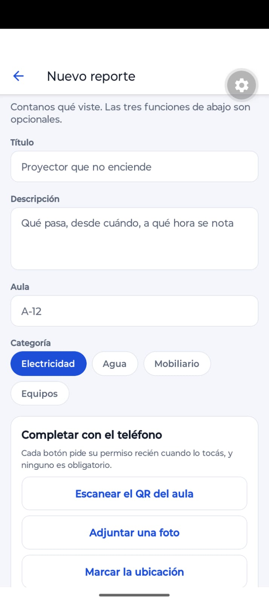

Las tres funciones están a la vista y ninguna pidió un permiso todavía. "Cada botón pide su
permiso recién cuando lo tocás, y ninguno es obligatorio."

### Cámara · de la previa al diálogo, y de ahí a bloqueado

| Pantalla previa | El diálogo del sistema |
| --- | --- |
| 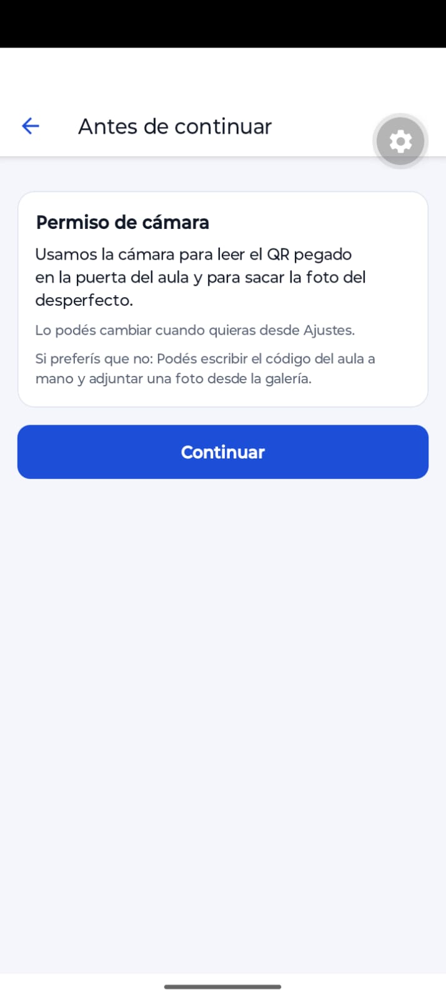 | 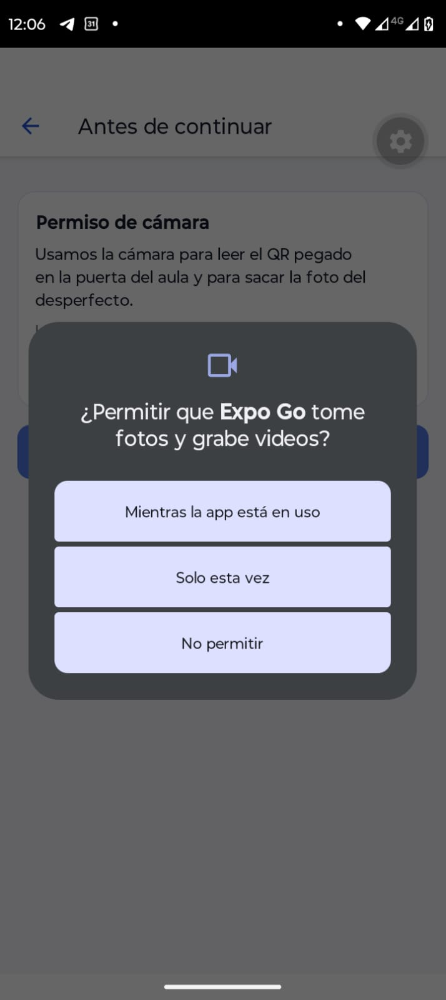 |

El par muestra el flujo completo del requisito 6: primero la explicación con un único botón
Continuar, y recién después el diálogo del sistema, que aparece **encima** de la previa.

| Escáner bloqueado, con la alternativa | La previa cuando ya está bloqueado |
| --- | --- |
| 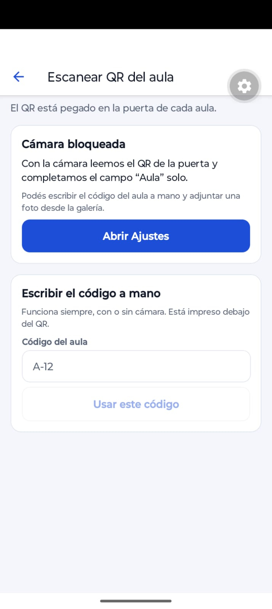 | 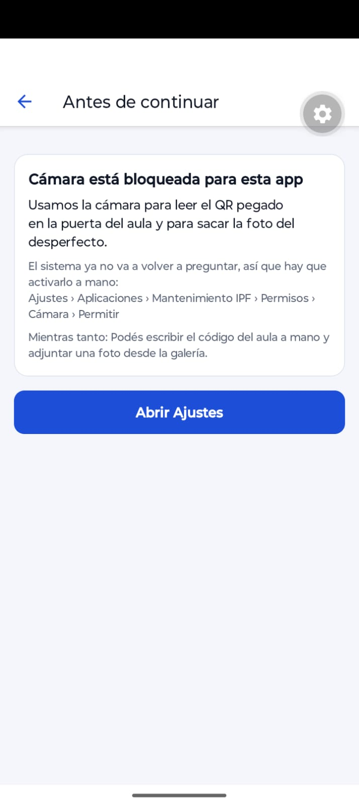 |

Acá se ven juntos el requisito 2 y el 7. El estado bloqueado no deja a la persona sin salida: el
campo "Escribir el código a mano" sigue ahí. Y la previa cambió sola de forma, el botón pasó a
ser "Abrir Ajustes" y apareció la ruta exacta de Android.

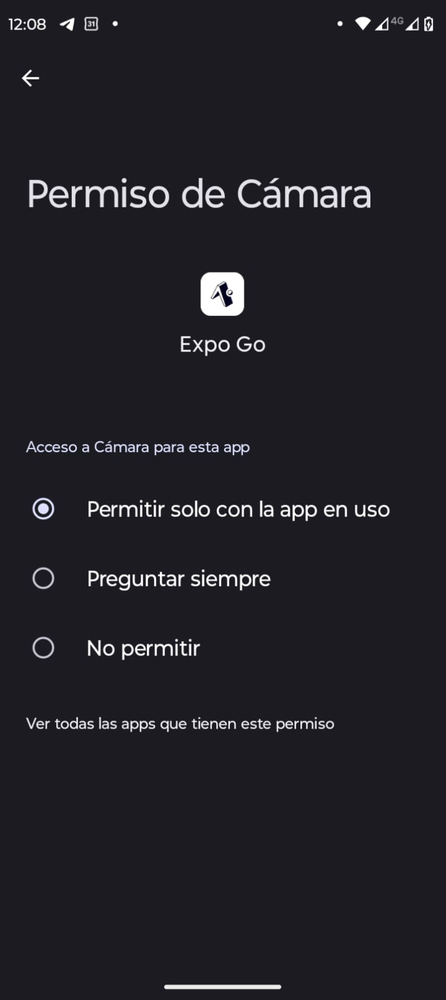

A donde lleva "Abrir Ajustes". Se ve "Permitir solo con la app en uso", "Preguntar siempre" y
"No permitir", que son los tres estados de Android del lado del sistema.

### Foto · el permiso que no se pide

| La pantalla | El selector del sistema |
| --- | --- |
| 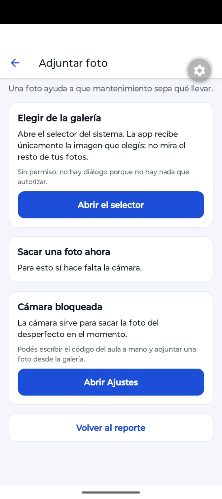 | 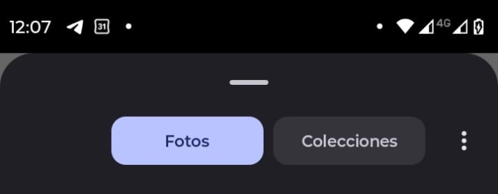 |

El requisito 3 en una imagen: "Sin permiso: no hay diálogo porque no hay nada que autorizar". El
selector se abre directo, sin pedir nada, y la app recibe sólo la foto elegida. En la misma
pantalla, "Sacar una foto ahora" sí depende de la cámara y por eso muestra su tarjeta de
permiso.

### Ubicación · preguntable, precisa o aproximada, y bloqueada

| La pantalla, sin permiso | La previa |
| --- | --- |
| 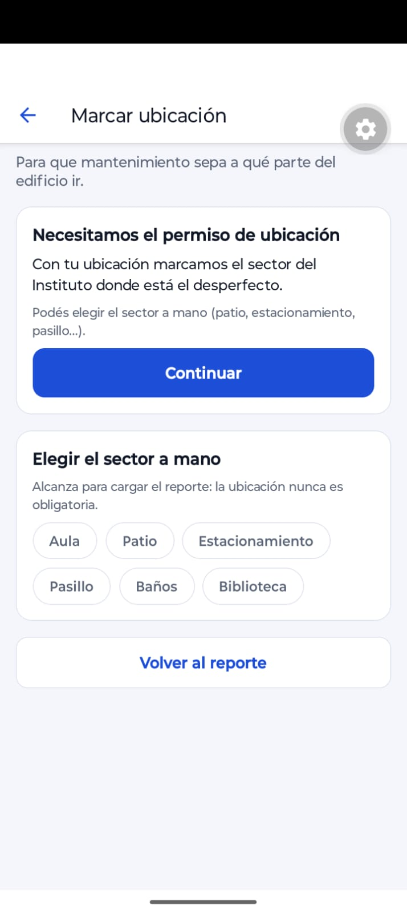 | 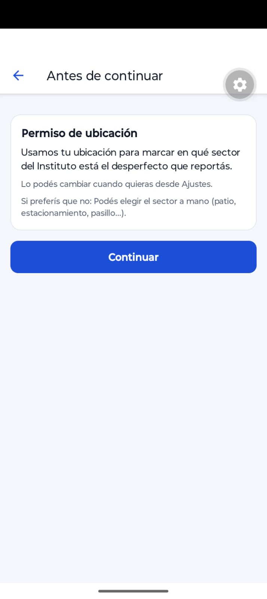 |

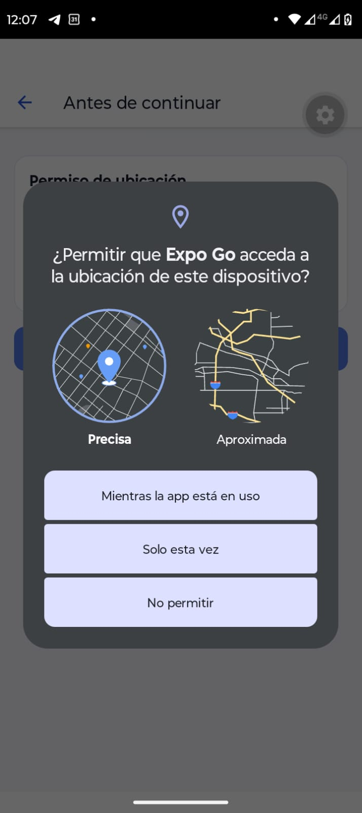

El diálogo de Android 12 con el selector de **Precisa** y **Aproximada**, y con "Solo esta vez".
Es la captura que conecta con B4b, B5 y D3: si la persona elige Aproximada, el permiso queda
concedido pero `android.accuracy` vale `'coarse'`, y la app muestra "Ubicación aproximada" en
lugar de coordenadas.

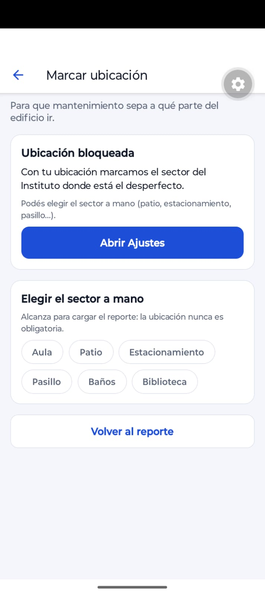

Bloqueada, con el selector de sector siempre disponible abajo. "Alcanza para cargar el reporte:
la ubicación nunca es obligatoria."

### Los permisos desde el lado del sistema

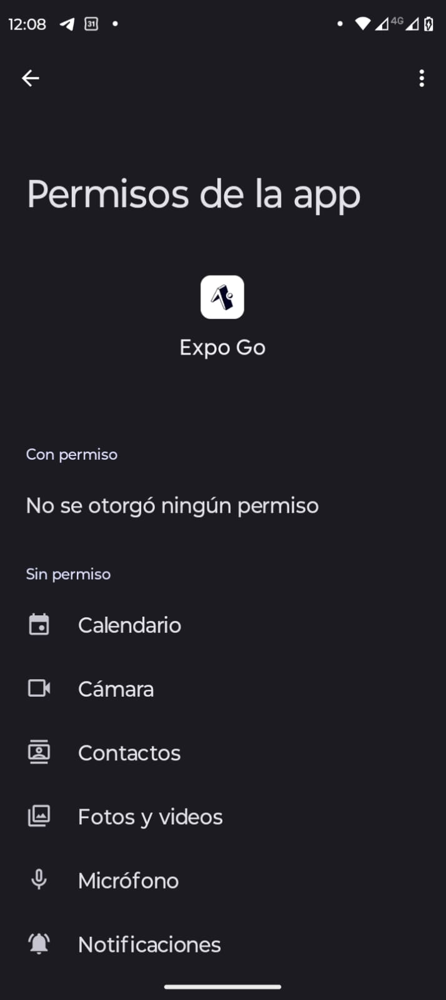

"No se otorgó ningún permiso", que es el estado inicial del que parten las capturas de arriba.

### El panel de permisos

| Cámara y ubicación | Notificaciones y fotos |
| --- | --- |
| 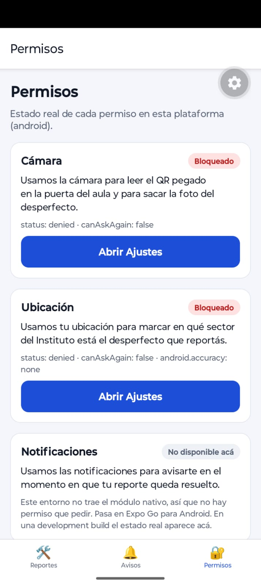 | 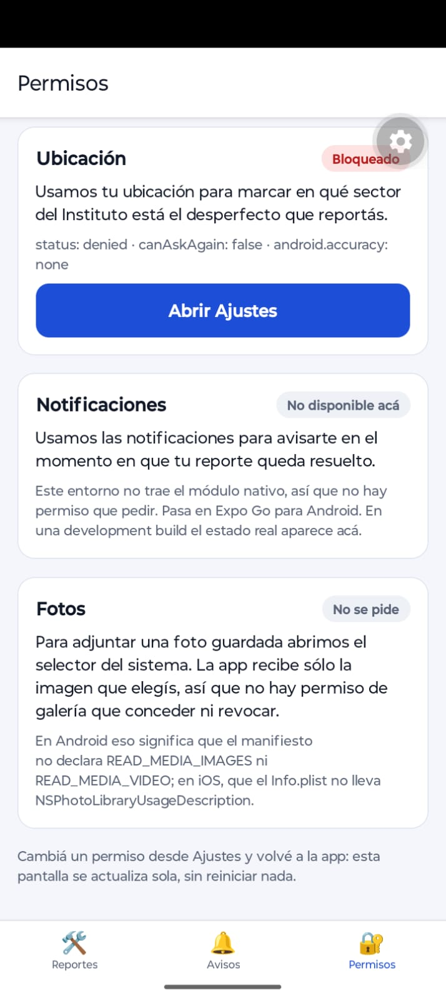 |

El requisito 9 completo. Cada recurso con su estado, la plataforma en el encabezado y los campos
crudos que devuelve Expo debajo de cada uno:

- **Cámara**: `status: denied · canAskAgain: false`. Los dos campos que deciden todo, y por eso
  el botón dice "Abrir Ajustes" y no "Continuar".
- **Ubicación**: lo mismo, más `android.accuracy: none`, que es el campo del matiz. Cuando el
  permiso se concede pasa a `'fine'` o `'coarse'`, y con `'coarse'` la app muestra "Ubicación
  aproximada" en lugar de coordenadas.
- **Notificaciones**: "No disponible acá". En Expo Go para Android el módulo nativo no está, así
  que no hay permiso que pedir. No es lo mismo que denegado, y la app lo distingue.
- **Fotos**: "No se pide", con la explicación de por qué la galería no aparece como permiso.

### Lo que falta

| Qué | Por qué no está |
| --- | --- |
| Escáner en cargando y en concedido | Pendiente. El de cargando dura un parpadeo y sale mejor de un video. |
| Ubicación concedida, con el chip de aproximada | Pendiente. |
| Notificación recibida a los 10 segundos | Pendiente. |
| El panel antes y después de volver de Ajustes | Está el panel, pero no el par que demuestra el refresco por `AppState`. |
| El diálogo con el texto de propósito propio | Necesita la development build, que no llegué a compilar. En Expo Go el diálogo muestra el texto de Expo Go, como se ve arriba. |

## Defensa oral

**1 · ¿Qué código decide entre Continuar y Abrir Ajustes? ¿Qué campo lo decide?**

Lo decide `canAskAgain`, en `estadoDesdeRespuesta()`, en
[`src/lib/permisos.ts`](./src/lib/permisos.ts):

```ts
if (!respuesta) return 'cargando';
if (respuesta.granted) return 'concedido';
return respuesta.canAskAgain ? 'preguntable' : 'bloqueado';
```

Después, en `pantalla-previa.tsx`, `'bloqueado'` renderiza el botón Abrir Ajustes con
`Linking.openSettings()` y `'preguntable'` el botón Continuar con `pedir()`. La lógica de fondo
es que `granted` responde "¿puedo usarlo?" y `canAskAgain` responde "¿tiene sentido mostrar el
diálogo?". De ahí sale la etiqueta del botón.

**2 · Revoco la cámara desde Ajustes con la app abierta y vuelvo. ¿Qué hace Android? ¿Cómo se
entera mi código?**

Android mata el proceso de la app, para que nada siga corriendo con un permiso que ya no tiene,
y al volver se reinicia desde cero. En iOS el proceso no se mata, pero el estado cambió igual.

Mi código se entera por `AppState`. `useRevisarAlVolver` escucha la transición de `background` a
`active` y llama a `consultar()`, que es el `get…`, nunca el `request…`. Sin eso, el panel
seguiría mostrando el estado viejo.

**3 · ¿Por qué no pido permiso para elegir una foto, pero sí para sacarla?**

Porque son dos cosas distintas. El selector del sistema corre fuera de la caja de arena de la
app: la persona elige una imagen y el sistema le pasa a la app sólo ésa, que nunca ve la
fototeca, así que no hay nada que autorizar.

Sacar una foto es usar el hardware de la cámara desde adentro de la app, y ahí sí se accede a un
recurso sensible en vivo. Es el principio de mínimo privilegio: si existe un selector del
sistema que resuelve la necesidad, ése es siempre el mejor camino, porque el mejor permiso es el
que no hace falta pedir.

**4 · ¿Qué cambia si la persona elige ubicación aproximada? ¿Y si la deniega?**

Con aproximada, el permiso está concedido pero `android.accuracy` vale `'coarse'`, o
`ios.accuracy` vale `'reduced'`. La app lo detecta con `esAproximada()`, pide la posición con
menor precisión y no muestra coordenadas: guarda el texto "Ubicación aproximada" y un chip de
aviso. Mostrar −26.18542, −58.17458 con 3 km² de margen sería mentir con números.

Si la deniega, `obtenerUbicacion()` devuelve `null` sin lanzar ninguna excepción, la pantalla
muestra la tarjeta de permiso con su alternativa y el reporte se carga con el sector elegido a
mano. La diferencia práctica para mantenimiento es que dice Patio en vez de un punto en el mapa,
y para encontrar una luz quemada eso alcanza perfectamente.

**5 · ¿Por qué mis textos de propósito no aparecían en Expo Go?**

Porque en Expo Go la app que corre es Expo Go, no la mía. Mi proyecto es JavaScript que Expo Go
interpreta, y el `Info.plist` y el `AndroidManifest.xml` que usa el sistema son los del binario
de Expo Go, compilados meses antes con textos genéricos para todos los módulos que trae. Mi
`app.json` no puede modificar el `Info.plist` de otra app. Por eso el diálogo dice que Expo Go
quiere acceder a la cámara, y por eso `blockedPermissions` tampoco hace nada ahí. Los textos
propios aparecen recién en una development build.

**6 · Si mañana agrego la nota de voz, ¿alcanza con una OTA?**

No. La nota de voz necesita `RECORD_AUDIO` en el manifiesto y `NSMicrophoneUsageDescription` en
el `Info.plist`, y hoy la app los bloquea a propósito.

Una OTA reemplaza el bundle de JavaScript, no el binario, y el manifiesto, el `Info.plist` y el
módulo nativo de `expo-audio` viajan adentro del binario. Si publicara sólo el JS, en Android la
solicitud devolvería denegado al instante sin mostrar diálogo, porque el permiso no está en el
manifiesto, y en iOS la app crashearía al tocar el micrófono. Hay que cambiar `app.json`, correr
`prebuild`, compilar una build nueva y publicarla.

---

## Decisiones de diseño

**Los datos viven en memoria.** `src/lib/store.tsx` es un Context, sin base de datos ni
`AsyncStorage`, así que al cerrar la app los reportes vuelven al estado inicial. Es
deliberado: el objeto del TP son los permisos, y agregar persistencia habría sumado una
dependencia y ruido sin enseñar nada sobre el tema. Hay dos reportes de ejemplo precargados para
que la lista no arranque vacía.

**`usePermiso` monta los hooks de los tres módulos, pero consulta uno solo.** Las reglas de los
hooks obligan a llamarlos siempre y en el mismo orden, pero sí se puede desactivar la consulta
automática con `{ get: recurso === 'camara', request: false }`. Así una pantalla que usa la
cámara no dispara ninguna lectura de ubicación.

**`expo-notifications` se carga a mano y dentro de un `try/catch`.** Esto no fue una decisión
de estilo, fue un bug que me comí al probar en el teléfono: en web andaba y en Android la app se
caía al arrancar con un error de `ExpoTopicSubscriptionModule`.

La causa está en la librería. `TopicSubscriptionModule.android.js` hace
`requireNativeModule('ExpoTopicSubscriptionModule')` en el cuerpo del módulo, y el `index.js` lo
reexporta, así que cualquier `import` de `expo-notifications` en Android pide ese módulo nativo
apenas se evalúa el archivo. Si ese módulo nativo no está, el import entero es fatal, y como
`_layout.tsx` llama a `configurarPresentacion()` al cargar, la app muere antes de dibujar la
primera pantalla. En web no pasa porque ahí se resuelve `TopicSubscriptionModule.js`, que es un
stub de JavaScript puro sin módulo nativo.

La solución fue sacar el `import` estático y cargar el módulo desde una función memoizada, con
`try/catch`. Si falla, `hayNotificaciones()` devuelve `false`, `usePermiso` expone
`disponible: false` y la interfaz lo dice con todas las letras en vez de ofrecer un "Abrir
Ajustes" que no arreglaría nada. En una development build el módulo existe y todo funciona
normal.

Terminó siendo la mejor demostración de la Parte D6 que tiene el trabajo: Expo Go no es tu app,
y acá se ve en el stack trace.

**La intención se guarda, el permiso se consulta.** En `/ajustes-app` el interruptor combina dos
cosas distintas: `quiereAvisos`, que es un dato de la app y sí se guarda, y `permiso.estado`,
que es del sistema y se consulta cada vez. El interruptor queda encendido sólo si las dos son
verdaderas. Cachear el permiso para siempre es lo que produce el "sigue diciendo bloqueado
después de activarlo en Ajustes".
