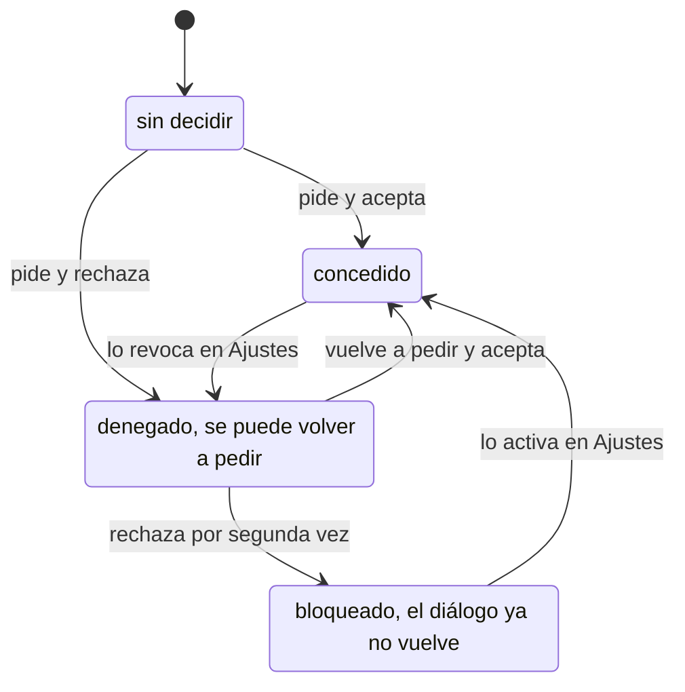
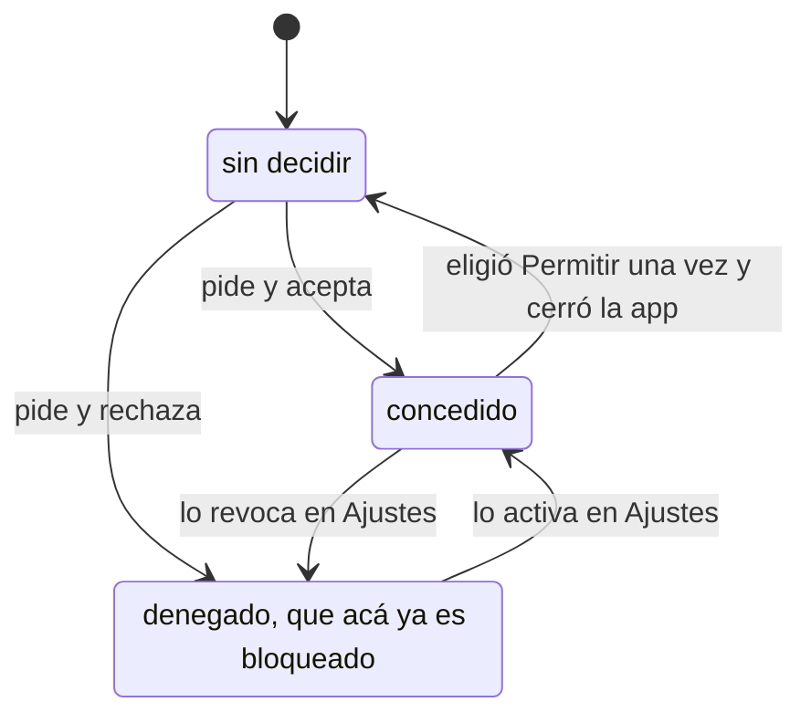
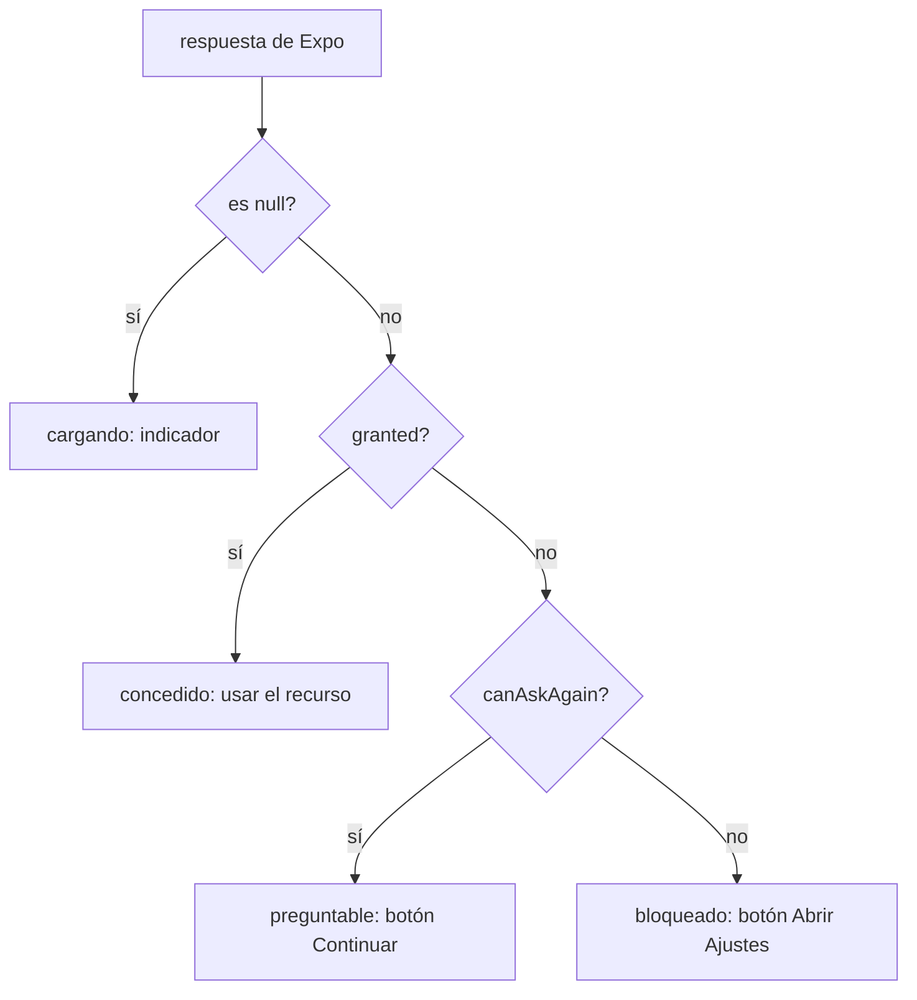

# Trabajo Práctico N° 3 — Permisos móviles: Android, iOS y Expo

**Taller Complementario – React Native II · Instituto Politécnico Formosa**

Partes A a F. La Parte G es la app que está en este mismo repositorio; el recorrido del código
está en [README.md](./README.md).

---

## Parte A · ¿Qué es un permiso y por qué existe?

### A1. Conceptos

**a) ¿Qué es un permiso?**

Es la autorización que el sistema operativo exige antes de dejar que una app toque un recurso
sensible: la cámara, el micrófono, la ubicación, los contactos, la capacidad de notificar. No
es una función del lenguaje ni una librería, es una regla del sistema, y se cumple aunque el
código intente lo contrario.

Los tres papeles son bien distintos:

- **La app** declara qué va a necesitar y lo solicita cuando le hace falta. Nunca se lo concede
  a sí misma.
- **El sistema operativo** es el único que puede conceder o negar. Dibuja el diálogo, guarda la
  respuesta y después deja pasar o bloquea cada llamada a la API protegida.
- **La persona usuaria** decide, y su respuesta pesa más que el código. Puede decir que no,
  puede cambiar de opinión más tarde desde Ajustes y puede revocar lo que ya había concedido.

**b) La caja de arena**

Cada app corre dentro de su propia caja: su proceso, su usuario de Linux en Android, su
directorio de archivos. Desde adentro no ve la memoria de otras apps, ni sus archivos, ni el
hardware sensible. Los permisos son las puertas de esa caja, y cada permiso concedido abre una
puerta concreta y nada más que ésa.

Sin ningún permiso una app todavía hace bastante. Dibuja su interfaz, lee y escribe en su
directorio privado, hace cálculos, lee los sensores no sensibles como el acelerómetro, abre
otras apps por deep link, usa el selector de archivos o de fotos del sistema y saca una foto
delegando en la app de cámara. En Android, además, `INTERNET` se concede solo al instalar.

El detalle clave del selector del sistema es que corre **fuera** de la caja: la persona elige
una foto y el sistema le entrega esa sola a la app, que nunca ve el resto.

**c) Las cuatro razones por las que existen**

| Razón | Ejemplo |
| --- | --- |
| **Privacidad** — hay datos que son de la persona, no de la app | Una app de linterna no tiene por qué leer la agenda de contactos. |
| **Seguridad** — evitar que una app haga daño o espíe | Sin permiso de micrófono, una app no puede grabar una reunión de fondo. |
| **Transparencia** — que la persona se entere de lo que pasa | El punto verde de iOS y Android avisa que la cámara está activa, aunque el permiso ya esté concedido. |
| **Control** — poder cambiar de opinión cuando sea | Concedo la ubicación para pedir un delivery y la revoco esa misma noche. |

**d) La analogía del portero**

La **visita** es la app, que quiere entrar a un departamento que no es suyo. El **portero** es
el sistema operativo: nadie entra sin pasar por él, y es él quien toca el timbre, no la visita.
El **dueño del departamento** es la persona usuaria, la única que puede decir que sí.

Que el portero se acuerde de la respuesta significa que la decisión queda persistida. El
sistema la guarda asociada a esa app y en las visitas siguientes ya no vuelve a tocar el
timbre: si fue que sí deja pasar directo, y si fue que no rebota a la visita sin molestar al
dueño. Por eso una app no puede reintentar hasta que la persona cambie la decisión desde
Ajustes, y por eso el estado sobrevive a cerrar la app y a reiniciar el teléfono.

### A2. Declarar y solicitar

| | **Declarar — al compilar** | **Solicitar — al ejecutar** |
| --- | --- | --- |
| **¿Qué se hace?** | Dejar escrito en el paquete qué recursos la app podría llegar a usar y, en iOS, con qué propósito. Es una promesa estática que viaja dentro del binario. | Mostrar el diálogo del sistema en el momento en que la función hace falta y leer la respuesta. Es dinámico, con la app corriendo. |
| **Android** | `<uses-permission android:name="android.permission.CAMERA" />` en `AndroidManifest.xml`. | `ActivityCompat.requestPermissions(...)` en nativo; desde Expo, `requestCameraPermissionsAsync()` o `useCameraPermissions()`. |
| **iOS** | Una clave de propósito en `Info.plist`, como `NSCameraUsageDescription`, con el texto que va a leer la persona. No hay una lista de permisos aparte. | La primera llamada a la API protegida dispara el diálogo. Con Expo, `requestCameraPermissionsAsync()`. |
| **Expo** | `app.json` o `app.config.ts`: los config plugins de cada módulo con sus textos, más `android.permissions` y `android.blockedPermissions`. `npx expo prebuild` traduce todo eso a manifiesto e `Info.plist`. | Las funciones y hooks de cada módulo: `useCameraPermissions()`, `Location.requestForegroundPermissionsAsync()`, `Notifications.requestPermissionsAsync()`. |
| **¿Qué pasa si se omite?** | En Android el diálogo nunca aparece y la solicitud devuelve denegado al instante. En iOS la app **crashea** al tocar la API protegida, y App Store Connect rechaza la build al subirla. | El permiso queda sin decidir para siempre y la app nunca accede al recurso. Declarar, por sí solo, no concede nada. |

### A3. Verdadero o falso

**a) El diálogo lo dibuja tu app con componentes de React Native. — FALSO**
Lo dibuja el sistema, fuera del proceso de la app. No podés cambiarle el texto, el estilo ni los
botones, ni leer qué está tocando la persona. Lo que sí podés dibujar es la pantalla previa.

**b) En Expo la fuente de verdad es `app.json`, no el `AndroidManifest.xml`. — VERDADERO**
`npx expo prebuild` regenera `android/` e `ios/` desde la configuración, así que todo lo que
edites a mano en el manifiesto se pierde en la próxima regeneración.

**c) Un permiso nuevo en el `Info.plist` se puede publicar con una OTA. — FALSO**
Una actualización OTA reemplaza el bundle de JavaScript y los assets, no el binario. El
`Info.plist`, el `AndroidManifest.xml` y los módulos nativos viajan adentro del binario:
cambiarlos exige compilar y publicar una build nueva.

**d) Si pedís un permiso que no está en el manifiesto, Android igual muestra el diálogo. — FALSO**
Android consulta primero el manifiesto. Si no está declarado no muestra nada y devuelve denegado
con `canAskAgain: false`. Es el origen del clásico "llamo a `request…()` y no pasa nada".

**e) `expo-permissions` es la forma recomendada en SDK 57. — FALSO**
Está deprecado desde SDK 41 y eliminado desde SDK 43. Hoy cada módulo trae sus propios métodos
y hooks.

**f) En iOS las notificaciones no llevan texto de propósito. — VERDADERO**
No tienen clave `NS…UsageDescription`. El diálogo lo arma iOS entero y el permiso se pide con
`Notifications.requestPermissionsAsync()`.

**g) Con acceso limitado a fotos, `status` vale `'granted'` y el matiz está en `accessPrivileges`. — VERDADERO**
Para la app el permiso está concedido, puede leer fotos. `accessPrivileges` distingue `'all'` de
`'limited'`, y hay que leerlo, porque con `'limited'` la galería que ve la app es sólo la
selección que hizo la persona.

**h) Desinstalar y reinstalar es la forma confiable de volver a "sin decidir". — FALSO**
En iOS suele funcionar, pero no siempre: el sistema recuerda decisiones recientes un tiempo. En
Android, encima, la restauración automática de copias de seguridad puede devolver permisos ya
concedidos. Lo confiable es resetear a propósito, con `adb shell pm reset-permissions` o
`xcrun simctl privacy booted reset all <bundleId>`.

### A4. Los estados de un permiso

**a) El diagrama**

Android:



iOS:



**La diferencia central** salta a la vista comparando los dos diagramas: en Android hay un
estado intermedio y en iOS no. Android da dos oportunidades de mostrar el diálogo, y desde
Android 11 el segundo "No permitir" equivale a "no volver a preguntar". iOS da una sola, así
que el primer rechazo ya deja el permiso bloqueado.

En la práctica eso significa que el estado "denegado pero se puede volver a pedir" hay que
programarlo sí o sí, porque en Android existe de verdad, aunque en iOS casi nunca se vea.

**b) Qué devuelve Expo**

| Estado | `status` | `canAskAgain` | ¿Puede aparecer el diálogo? |
| --- | --- | --- | --- |
| Sin decidir | `'undetermined'` | `true` | Sí. Es el único caso en que aparece seguro. |
| Concedido | `'granted'` | `true` | No hace falta. `request…()` resuelve sin mostrar nada. |
| Denegado, se puede volver a pedir | `'denied'` | `true` | Sí, en Android y sólo tras el primer rechazo. |
| Bloqueado | `'denied'` | `false` | No. `request…()` resuelve igual, con el mismo `denied`, en silencio. Sólo Ajustes lo cambia. |

---

## Parte B · Android: tipos de permisos y manifiesto

### B1. Clasificá los permisos

| Permiso | Tipo | ¿Cómo se obtiene? |
| --- | --- | --- |
| `INTERNET` | Instalación, nivel *normal* | Se concede solo al instalar, con declararlo alcanza. Sin diálogo. |
| `CAMERA` | Tiempo de ejecución | Declarar y pedirlo con `requestCameraPermissionsAsync()`. El sistema muestra el diálogo. |
| `VIBRATE` | Instalación | Se concede solo al instalar. |
| `SYSTEM_ALERT_WINDOW` | **Especial** | Declarar y mandar a la persona a la pantalla "Mostrar sobre otras apps" de Ajustes. No hay diálogo. |
| `POST_NOTIFICATIONS` | Tiempo de ejecución desde Android 13 | Declarar y pedirlo. En Android 12 o anterior se concede solo. |
| `ACCESS_NETWORK_STATE` | Instalación | Se concede solo al instalar. |
| `READ_CONTACTS` | Tiempo de ejecución | Declarar y pedirlo con diálogo. Desde el 27/01/2027 Google Play además exige una declaración si apuntás a API 37+. |
| `SCHEDULE_EXACT_ALARM` | **Especial** desde Android 12 | Declarar y mandar a "Alarmas y recordatorios" en Ajustes. Para muchos casos conviene `USE_EXACT_ALARM`, que se concede solo pero tiene política de tienda estricta. |
| `RECORD_AUDIO` | Tiempo de ejecución | Declarar y pedirlo con diálogo. |
| `MANAGE_EXTERNAL_STORAGE` | **Especial** | Declarar, mandar a "Acceso a todos los archivos" y además justificarlo ante Google Play, que lo aprueba caso por caso. |

### B2. Grupos y nombres

**a)** Un grupo reúne los permisos que tocan el mismo recurso conceptual: `LOCATION`, `CAMERA`,
`CONTACTS`, `MICROPHONE`. El diálogo habla del grupo, no del permiso individual, así que pedir
`ACCESS_FINE_LOCATION` y `ACCESS_COARSE_LOCATION` juntos muestra **un solo diálogo**: el de
ubicación, que desde Android 12 trae adentro el selector de precisa o aproximada.

**b)** El prefijo es `android.permission.`, y el nombre completo del permiso de cámara es
`android.permission.CAMERA`. Los permisos que define otra librería llevan su propio prefijo,
como `com.google.android.gms.permission.ACTIVITY_RECOGNITION`.

**c)** Los permisos de firma sólo se conceden a una app firmada con el mismo certificado que la
app que los define. No hay diálogo ni Ajustes: o la firma coincide o no se conceden. Se usan
entre apps del mismo fabricante. En una app común no sirven, porque no controlás la firma de la
otra parte.

### B3. Leé el manifiesto

**a) Qué se concede solo y qué hay que pedir**

`INTERNET` se concede solo al instalar. Hay que pedir en tiempo de ejecución `CAMERA`,
`ACCESS_COARSE_LOCATION` y `ACCESS_FINE_LOCATION` — las dos últimas con un único diálogo — y
`POST_NOTIFICATIONS`.

`READ_EXTERNAL_STORAGE` también es de tiempo de ejecución, pero sólo existe hasta Android 12.
Y `RECORD_AUDIO` ni siquiera llega al APK: `tools:node="remove"` lo saca.

**b) `android:maxSdkVersion="32"`**

El permiso se instala y se pide sólo hasta API 32. Desde API 33 Android ya no lo incluye en el
paquete. Sirve para los permisos que una versión nueva reemplazó, y evita pedir en Android 13+
algo que ahí no existe.

Desde Android 13 `READ_EXTERNAL_STORAGE` quedó partido por tipo de medio: `READ_MEDIA_IMAGES`,
`READ_MEDIA_VIDEO` y `READ_MEDIA_AUDIO`. Android 14 suma `READ_MEDIA_VISUAL_USER_SELECTED`, que
es el acceso parcial.

**c) `tools:node="remove"`**

Es una instrucción para el manifest merger de Gradle: cuando fusiones los manifiestos, borrá
esta entrada. Sirve para sacar un permiso que declara una **librería** y que tu app no usa. Sin
esto, la librería lo mete igual y la ficha de Play lo muestra.

En Expo no se escribe a mano, lo genera `blockedPermissions`:

```json
{
  "expo": {
    "android": {
      "blockedPermissions": ["android.permission.RECORD_AUDIO"]
    }
  }
}
```

**d) Agregar `SCHEDULE_EXACT_ALARM`**

Va en `expo.android.permissions`, que es la lista de permisos extra que ninguna librería
declara:

```json
{
  "expo": {
    "android": {
      "permissions": ["android.permission.SCHEDULE_EXACT_ALARM"]
    }
  }
}
```

Declararlo no alcanza, igual: es un permiso especial y hay que llevar a la persona a la pantalla
de Ajustes.

**e) Por qué no conviene editarlo a mano**

Porque `android/` es una carpeta generada. `prebuild` la vuelve a crear desde `app.json` y
cualquier edición manual desaparece. Encima suele estar en `.gitignore`, así que el cambio
tampoco viaja al repositorio ni a EAS Build.

**`blockedPermissions` en Expo Go no funciona.** Expo Go es una app ya compilada, con su propio
manifiesto, que declara todos los permisos que puedan necesitar los módulos que trae. Tu
`app.json` no lo modifica. Lo mismo pasa con los textos de propósito: recién tienen efecto en
una development build.

### B4. Así pregunta Android

**a)** No se puede. El texto lo arma el sistema a partir del grupo y la app no puede agregar
nada. Por eso la explicación va antes, en una pantalla propia o en el contexto de la pantalla
desde la que se pide.

**b)** "Mientras la app está en uso" concede el permiso de forma persistente, pero sólo mientras
la app está en primer plano y un rato después. "Solo esta vez" concede un permiso temporal que
se revoca al salir: la próxima vez vuelve a estar sin decidir. Existe desde Android 11 para los
tres recursos más sensibles: ubicación, cámara y micrófono.

**c)** Desde Android 11, dos "No permitir" equivalen a "no volver a preguntar". `canAskAgain`
pasa a `false`, `status` queda en `'denied'` y las llamadas siguientes a `request…()` resuelven
sin mostrar nada. El único camino es Ajustes.

**d)** Con unos 3 km² de margen alcanza para mostrar el clima de la ciudad, elegir el idioma o
la moneda del país, listar "sucursales en tu zona" o elegir el servidor más cercano. No alcanza
para navegación paso a paso, geocercas chicas, registrar el recorrido de una carrera ni para
encontrar el auto en el estacionamiento.

**e)** Android **mata el proceso de la app**, para que ningún código siga corriendo con un
permiso que ya no tiene. Para la persona, la app se reabre desde cero. Ése es el motivo por el
que al volver de Ajustes conviene volver a consultar en lugar de confiar en lo que quedó en
memoria. En iOS el proceso no se mata, pero el estado cambió igual.

### B5. Android, versión por versión

| Cambio | Versión | Qué implica para el código |
| --- | --- | --- |
| Nacen los permisos en tiempo de ejecución | **6.0 · API 23** | Declarar deja de alcanzar: hay que pedir y leer la respuesta en cada uso. Nace el estado denegado. |
| La ubicación en segundo plano pasa a ser un permiso aparte | **10 · API 29** | `ACCESS_BACKGROUND_LOCATION` se pide por separado, y sólo tiene sentido si ya tenés el de primer plano. |
| Dos rechazos equivalen a "no volver a preguntar" | **11 · API 30** | Hay que manejar `canAskAgain: false`: el botón deja de ser "Continuar" y pasa a ser "Abrir Ajustes". Además el permiso de background ya no se puede pedir con diálogo, hay que mandar a Ajustes. |
| Ubicación precisa o aproximada | **12 · API 31** | El diálogo trae el selector. Hay que leer `android.accuracy` y degradar la función si vino `'coarse'`. |
| Las notificaciones pasan a ser un permiso | **13 · API 33** | Notificar deja de estar garantizado. Hay que declarar, crear el canal y pedir `POST_NOTIFICATIONS` en contexto. |
| Acceso parcial a fotos y videos | **14 · API 34** | Aparece `READ_MEDIA_VISUAL_USER_SELECTED` y `granted` puede significar "sólo estas fotos". Lo más sano es no pedir el permiso y usar el photo picker. |
| Permiso de red local | **16 · API 36** opt-in y **17 · API 37** obligatorio | Hablar con un dispositivo de la red local pasa a necesitar permiso en tiempo de ejecución. Las apps que apuntan a menos de API 37 reciben una concesión implícita y temporal, así que la recomendación oficial es no pedirlo al runtime hasta apuntar a 37. |

**El `targetSdkVersion`** es la versión de Android para la que la app declara estar preparada.
El sistema la usa para decidir qué cambios de comportamiento le aplica: una app con `targetSdk`
32 sigue sin necesitar `POST_NOTIFICATIONS` aunque corra en Android 14, porque Android le
mantiene el comportamiento viejo. Subirlo es aceptar las reglas nuevas.

Expo SDK 57 apunta a **API 36**, con `minSdkVersion` 24 y `compileSdk` 36. Lo verifiqué en
`android/build.gradle` después de correr `prebuild`. Y Google Play exige, **desde el 31 de
agosto de 2026**, que las apps nuevas y las actualizaciones apunten a API 36, con prórroga
posible hasta el 1/11/2026. O sea que SDK 57 ya cumple sin tocar nada.

---

## Parte C · iOS: textos de propósito y acceso parcial

### C1. Claves del `Info.plist`

| Recurso | Clave |
| --- | --- |
| Cámara | `NSCameraUsageDescription` |
| Micrófono | `NSMicrophoneUsageDescription` |
| Ubicación en uso | `NSLocationWhenInUseUsageDescription` |
| Ubicación siempre | `NSLocationAlwaysAndWhenInUseUsageDescription`, más la de "en uso", que es obligatoria igual |
| Fotos, leer | `NSPhotoLibraryUsageDescription` |
| Fotos, solo guardar | `NSPhotoLibraryAddUsageDescription` |
| Contactos | `NSContactsUsageDescription` |
| Face ID | `NSFaceIDUsageDescription` |
| Rastreo entre apps | `NSUserTrackingUsageDescription` |
| Notificaciones | **No lleva clave.** El texto del diálogo lo arma iOS entero. |

`NSLocationAlwaysUsageDescription` quedó sólo para iOS 10 y anteriores.

### C2. Sin texto, no hay permiso

**a)** Si falta el texto y la app toca la cámara, iOS mata la app en el acto. El mensaje es
"This app has crashed because it attempted to access privacy-sensitive data without a usage
description", y no es un error que puedas capturar con `try/catch`: el sistema termina el
proceso.

Al subir la build, App Store Connect la rechaza antes de llegar a revisión con el error
**`ITMS-90683: Missing Purpose String in Info.plist`**, nombrando la clave que falta.

**b)** Una sola vez. iOS muestra el diálogo de cada permiso una única vez en la vida de la
instalación. Si la persona dice que no, a la app le quedan dos cosas: seguir funcionando con
una alternativa que no use ese recurso, y ofrecer un camino claro a Ajustes con
`Linking.openSettings()`. Lo que no le queda es volver a mostrar el diálogo.

**c)** iOS arma el encabezado y los botones. Vos escribís únicamente la frase del medio, que es
el texto de propósito del `Info.plist`. En Expo se configura en `app.json`, en las props del
config plugin del módulo:

```json
["expo-camera", {
  "cameraPermission": "Usamos la cámara para leer el QR pegado en la puerta del aula…"
}]
```

También se puede escribir directo en `expo.ios.infoPlist`, pero el plugin es lo recomendado
porque además agrega el permiso de Android correspondiente.

**d)** Pasa porque el chequeo de Apple es estático: analiza el binario y, si encuentra una API
protegida enlazada, exige la clave, aunque esté en el código de una librería y tu app nunca la
llame. El SDK de la librería viaja dentro de tu binario, así que para Apple es tu app la que la
usa.

Hay tres salidas, en orden de preferencia. La mejor es sacar la librería o reemplazarla por una
que no enlace esa API, porque si no la usás, no la lleves. La segunda es apagar la función
desde el config plugin, que es justo lo que hace `microphonePermission: false` en
`expo-camera`. La última es agregar la clave igual, con un texto honesto, y es la peor: le
estás pidiendo a la persona algo que no necesitás.

Si la API además está en la lista de *required reason APIs*, hay que declarar el motivo en el
manifiesto de privacidad.

### C3. Probador de textos de propósito

La pauta 5.1.1 pide explicar específicamente cómo se usa el dato y qué gana la persona. "Lo
necesita el sistema" o "mejora tu experiencia" no son razones.

| Texto propuesto | ¿Aprobado? | Versión mejorada |
| --- | --- | --- |
| "Necesitamos tu ubicación." | **No.** Dice qué pide, no para qué. No hay beneficio por ningún lado. | "Usamos tu ubicación para mostrarte las farmacias de turno que tenés a menos de diez cuadras." |
| "Para mejorar tu experiencia." | **No.** Es el ejemplo de manual de lo genérico: sirve para cualquier permiso de cualquier app, o sea para ninguno. | "Usamos tu ubicación para ordenar las farmacias de turno de la más cercana a la más lejana." |
| "Usamos tu ubicación para mostrarte las farmacias de turno más cercanas." | **Sí.** Dice el dato, el uso y el beneficio concreto en una sola frase. | — |
| "La app no funciona sin ubicación." | **No.** No explica nada y encima suena a amenaza. Apple lo lee como coacción, y además suele ser mentira: algo se puede hacer igual. | "Usamos tu ubicación para encontrar farmacias cerca tuyo. Si preferís, podés buscar por barrio a mano." |
| "Ubicación requerida por el sistema." | **No.** Es falso: el sistema no requiere nada, la que pide es la app. Echarle la culpa al sistema es justamente lo que la pauta prohíbe. | "Usamos tu ubicación para mostrarte qué farmacia de turno te queda más cerca ahora." |

### C4. Acceso parcial y gradual

| Caso | iOS | En Expo |
| --- | --- | --- |
| Fotos limitadas | **14** | `expo-media-library`: `accessPrivileges === 'limited'`. Se amplía la selección con `MediaLibrary.presentPermissionsPickerAsync()`. |
| Ubicación aproximada | **14** | `expo-location`: `respuesta.ios.accuracy`, que vale `'reduced'` o `'full'`. |
| Permitir una vez | **13** | No tiene campo propio, llega como `status: 'granted'`. Se nota porque al reabrir la app el permiso volvió a `'undetermined'`, así que hay que consultarlo en cada arranque. |
| Ubicación escalonada | **13** | Primero `requestForegroundPermissionsAsync()` y recién después, cuando la función lo justifique, `requestBackgroundPermissionsAsync()`. El resultado se lee en `ios.scope`. |
| Notificaciones provisionales | **12** | `requestPermissionsAsync({ ios: { allowProvisional: true } })`, y se detecta con `respuesta.ios.status === IosAuthorizationStatus.PROVISIONAL`. |
| Rastreo entre apps | **14.5** | `expo-tracking-transparency`: `requestTrackingPermissionsAsync()`, con `NSUserTrackingUsageDescription` en el `Info.plist`. |

Expo SDK 57 requiere **iOS 16.4**, que es el `ios.deploymentTarget` por defecto del `Podfile`
que genera `prebuild` en este proyecto.

La consecuencia práctica es que todas las funciones de la tabla ya existen en el piso
soportado. No hace falta ni un solo chequeo de versión: el código puede leer `accessPrivileges`,
`ios.accuracy` o `IosAuthorizationStatus.PROVISIONAL` sabiendo que el campo siempre está. Lo que
hay que programar no son versiones, son matices: que `granted` pueda significar "sólo estas
fotos", "aproximada" o "sólo esta vez".

### C5. Android vs iOS, lado a lado

| | **Android** | **iOS** |
| --- | --- | --- |
| ¿Dónde se declara? | `AndroidManifest.xml`, con `<uses-permission>`. | `Info.plist`, con una clave que **incluye el texto**. |
| Texto en el diálogo | Lo arma el sistema a partir del grupo. La app no puede agregar nada. | Lo escribe la app y el sistema lo enmarca. |
| Oportunidades para preguntar | Dos. Al segundo rechazo queda bloqueado, desde Android 11. | Una sola. El no es definitivo para la app. |
| Solo esta vez | Desde Android 11, para ubicación, cámara y micrófono. | Desde iOS 13, sólo para ubicación. |
| Notificaciones | Permiso de tiempo de ejecución desde Android 13, y necesita el canal creado antes. | Permiso de siempre, sin clave en el `Info.plist`. Admite modo provisional, sin diálogo. |
| Ubicación en segundo plano | Permiso aparte desde Android 10. Desde Android 11 no se puede pedir con diálogo, hay que mandar a Ajustes, y Google Play lo revisa a mano. | Se pide después del de primer plano. iOS además manda recordatorios periódicos de uso. |
| Si falta la declaración | No aparece ningún diálogo, la solicitud devuelve denegado al instante. | La app crashea y App Store Connect rechaza la build. |

---

## Parte D · Expo: una API, dos plataformas

### D1. Módulos y funciones

| Necesidad | Módulo | Hook o función |
| --- | --- | --- |
| Escanear un QR con la cámara | `expo-camera` | `useCameraPermissions()` |
| Grabar video con sonido | `expo-camera` | `useCameraPermissions()` **y** `useMicrophonePermissions()`, que son dos permisos distintos |
| Mostrar farmacias cercanas | `expo-location` | `useForegroundPermissions()` |
| Seguir un envío en segundo plano | `expo-location` con `expo-task-manager` | `requestForegroundPermissionsAsync()` primero y después `requestBackgroundPermissionsAsync()` |
| Mostrar un recordatorio | `expo-notifications` | `requestPermissionsAsync()`, con `setNotificationChannelAsync()` antes en Android |
| Grabar una nota de voz | `expo-audio` | `AudioModule.requestRecordingPermissionsAsync()` |
| Galería propia dentro de la app | `expo-media-library` | `usePermissions()`, mirando `accessPrivileges` |
| Publicidad personalizada entre apps | `expo-tracking-transparency` | `requestTrackingPermissionsAsync()` |

Si un tutorial usa `import * as Permissions from 'expo-permissions'`, quedó viejo. Ese paquete
está deprecado desde SDK 41 y eliminado desde SDK 43, así que el tutorial es de 2020 o 2021 y
probablemente todo lo demás también esté desactualizado. No sirve como referencia para SDK 57.

### D2. Consultar, pedir y el hook

**a)** `get…PermissionsAsync()` sólo lee el estado actual: nunca muestra un diálogo y no tiene
ningún efecto visible. Sirve para decidir qué dibujar al entrar a una pantalla.

`request…PermissionsAsync()` es la única que puede mostrar el diálogo, y lo hace sólo si
corresponde. Si el permiso ya está concedido, o si está bloqueado, resuelve en silencio
devolviendo el estado que ya había. Las dos devuelven el mismo `PermissionResponse`.

**b)** Los tres elementos son la respuesta actual, la función que pide y la función que
consulta:

```ts
const [permiso, pedirPermiso, consultarPermiso] = Location.useForegroundPermissions();
```

En el **primer render `permiso` vale `null`**, porque la consulta inicial es asíncrona. Ése es
el estado que casi nadie dibuja y el que rompe las apps, porque `permiso.status` sobre `null`
revienta. Mientras tanto la pantalla tiene que mostrar un indicador de carga, nunca la pantalla
de permiso denegado: todavía no sabemos nada, y mostrar el error sería mentirle a la persona
durante un parpadeo.

**c)** Si `canAskAgain` es `false`, `request…()` no muestra nada. Resuelve al instante con el
mismo `status: 'denied'`, así que para el código es una llamada normal que no hace nada.

El problema aparece al llamarla en un bucle, por ejemplo desde el cuerpo de un componente o
desde un `useEffect` sin dependencias. La promesa resuelve siempre, el estado cambia de
identidad, el componente se vuelve a renderizar y se vuelve a llamar. Queda un bucle infinito
de renders: la pantalla se congela en "Pidiendo permiso…" para siempre y el teléfono se
calienta, todo sin un solo diálogo a la vista. Por eso `pedir()` tiene que salir de un
`onPress`, nunca de un render.

### D3. Leé la respuesta

| Respuesta | Qué hace la app |
| --- | --- |
| `null` | **Esperar.** Es el primer render: mostrar un indicador y no decidir nada todavía. |
| `{ status: 'granted', granted: true }` | **Usar el recurso.** Mostrar la cámara, leer la ubicación, programar el aviso. |
| `{ status: 'undetermined', canAskAgain: true }` | **Nunca se pidió nada.** Mostrar la pantalla previa con el beneficio y un botón que dispare `request…()`. |
| `{ status: 'denied', canAskAgain: true }` | **Dijo que no una vez.** Mostrar la alternativa y dejar un camino para reintentar, pero sólo si la persona vuelve a tocar la función. |
| `{ status: 'denied', canAskAgain: false }` | **Bloqueado.** Explicar cómo activarlo, ofrecer "Abrir Ajustes" y dejar la alternativa funcionando. |
| `{ status: 'granted', accessPrivileges: 'limited' }` | **Concedido a medias.** Trabajar con las fotos elegidas, decirlo en la interfaz y ofrecer elegir más, en vez de tratarlo como un error. |
| `{ status: 'granted', android: { accuracy: 'coarse' } }` | **Concedido, pero aproximado.** Mostrar "Ubicación aproximada" en lugar de coordenadas y no prometer precisión que no hay. |

Los dos campos que deciden casi todo son `granted` y `canAskAgain`. El primero responde "¿puedo
usar el recurso ahora?" y el segundo, "¿tiene sentido que muestre el diálogo?". De ahí sale
todo lo demás, incluido si el botón dice Continuar o Abrir Ajustes:



El resto de los campos son matices. `accessPrivileges`, `android.accuracy` y `ios.scope` sirven
para ajustar cómo se usa el recurso, no si se puede usar.

### D4. Simulación del ciclo completo

Android 14, app recién instalada, `expo-location`:

| # | Acción | `status` | `canAskAgain` | ¿Diálogo? |
| --- | --- | --- | --- | --- |
| 1 | `getForegroundPermissionsAsync()` | `'undetermined'` | `true` | **No.** `get…` nunca muestra nada. |
| 2 | `request…()` y toca No permitir | `'denied'` | `true` | **Sí**, es el primer rechazo. |
| 3 | `request…()` y toca No permitir | `'denied'` | **`false`** | **Sí**, y es el último. |
| 4 | `request…()` | `'denied'` | `false` | **No.** Resuelve en silencio, ya está bloqueado. |
| 5 | Va a Ajustes, habilita "Mientras la app está en uso", vuelve y la app consulta | `'granted'` | `true` | **No**, el cambio se hizo afuera. Android además mató y reinició el proceso. |
| 6 | Lo mismo, pero la app no vuelve a consultar | — | — | La pantalla sigue mostrando bloqueado con el botón "Abrir Ajustes", aunque el permiso ya esté concedido. Es el bug clásico: el estado quedó en memoria. Se arregla consultando cuando `AppState` pasa a `'active'`. |

Los mismos pasos en iOS cambian en el **paso 3**. Como el diálogo se muestra una sola vez, el
rechazo del paso 2 ya deja `canAskAgain: false`, así que del 3 en adelante no aparece nada. La
razón es de diseño: iOS entiende que si la persona ya dijo que no, volver a preguntar es
insistir, mientras que Android prefiere dar una segunda oportunidad por si el primer no fue un
reflejo.

| # | Acción | `status` | `canAskAgain` | ¿Diálogo? |
| --- | --- | --- | --- | --- |
| 1 | `getForegroundPermissionsAsync()` | `'undetermined'` | `true` | No |
| 2 | `request…()` y toca No permitir | `'denied'` | **`false`** | **Sí**, la única vez |
| 3 | `request…()` | `'denied'` | `false` | No |
| 4 | `request…()` | `'denied'` | `false` | No |

Y si en iOS elige "Permitir una vez", mientras la app está en uso `status` vale `'granted'` y
todo funciona normal. Pero el permiso es temporal: al cerrar la app iOS lo descarta, y al
reabrirla el estado vuelve a `'undetermined'`, no a `'denied'`. El diálogo puede volver a
aparecer, así que la app no debe cachear "ya tengo ubicación" entre sesiones.

### D5. Configurar `app.json`

Para una app que lee QR pero no graba video, usa ubicación sólo en primer plano y no debe
declarar `SYSTEM_ALERT_WINDOW`:

```jsonc
{
  "expo": {
    "plugins": [
      [
        "expo-camera",
        {
          "cameraPermission": "Usamos la cámara para leer el QR del punto de reciclaje.",
          // Sin micrófono: no se escribe NSMicrophoneUsageDescription.
          "microphonePermission": false,
          // Y el plugin manda RECORD_AUDIO a blockedPermissions.
          "recordAudioAndroid": false
        }
      ],
      [
        "expo-location",
        {
          "locationWhenInUsePermission":
            "Usamos tu ubicación para mostrarte los puntos de reciclaje más cercanos.",
          // Las dos claves de "siempre" se omiten del Info.plist.
          "locationAlwaysAndWhenInUsePermission": false,
          "locationAlwaysPermission": false,
          // Y en Android no se declara ACCESS_BACKGROUND_LOCATION.
          "isAndroidBackgroundLocationEnabled": false,
          "isAndroidForegroundServiceEnabled": false
        }
      ]
    ],
    "android": {
      "blockedPermissions": [
        "android.permission.SYSTEM_ALERT_WINDOW",
        "android.permission.RECORD_AUDIO",
        "android.permission.ACCESS_BACKGROUND_LOCATION"
      ]
    }
  }
}
```

**`expo-camera` agrega `RECORD_AUDIO`** porque el módulo trae la grabación de video completa, y
el manifiesto de una librería declara lo que el módulo *puede* hacer, no lo que tu app hace. El
manifest merger de Gradle fusiona el manifiesto de cada dependencia con el de la app, así que
`RECORD_AUDIO` termina en el APK aunque nunca llames a `recordAsync()`. Resultado: la ficha de
Play dice Micrófono y la persona ve un permiso que no se usa. `recordAudioAndroid: false` lo
resuelve generando el `tools:node="remove"`.

### D6. Expo Go no es tu app

**a)** Porque en Expo Go la app que corre es Expo Go, no la tuya. Tu proyecto es JavaScript que
Expo Go interpreta, y el binario con su `Info.plist` y su `AndroidManifest.xml` es el de Expo
Go, compilado meses antes con textos genéricos para todos los módulos que trae. Tu `app.json`
no puede modificar el `Info.plist` de otra app. Por eso el diálogo dice "Expo Go quiere acceder
a la cámara", y por eso `blockedPermissions` tampoco hace nada ahí.

**b)** En Expo Go se puede probar la lógica de permisos: los cuatro estados, las pantallas
previas, qué pasa al denegar, el regreso de Ajustes y las alternativas. No se puede probar lo
que depende del binario: tus textos de propósito, la lista real de permisos, los módulos
nativos que Expo Go no incluye y la configuración de los config plugins.

Los dos casos de la consigna:

- **Push en Android.** Desde SDK 53 las notificaciones push remotas de Android no funcionan en
  Expo Go, hace falta una development build con su propio FCM. Las notificaciones locales
  programadas sí andan, que es lo que usa este TP.
  Armando la Parte G me crucé con las dos caras de esto. En Expo Go para Android la app se
  cayó al arrancar con un error de `ExpoTopicSubscriptionModule`, que es el módulo nativo que
  `expo-notifications` pide apenas se lo importa, y en web andaba sin problema. Lo resolví
  cargando el módulo dentro de un `try/catch` en vez de importarlo arriba del archivo. Y una
  vez que importa bien, la propia librería avisa por consola que el push remoto de Android no
  está disponible en Expo Go, pero que las notificaciones locales siguen funcionando, que es
  justamente lo que usa este trabajo.
- **Ubicación en segundo plano.** Necesita `ACCESS_BACKGROUND_LOCATION` y el foreground service
  declarados en tu manifiesto, más tareas registradas con `expo-task-manager`. Nada de eso
  existe en Expo Go, hay que compilar.

**c)** Los comandos:

```bash
# Ver los archivos nativos generados
npx expo prebuild
npx expo prebuild --clean          # los borra y los regenera desde cero

# Compilar una development build de Android
npx expo run:android                                  # local, con Android Studio
eas build --profile development --platform android    # en la nube, con EAS
```

**d)** Para volver un permiso a sin decidir:

```bash
# Android
adb shell pm reset-permissions                                            # todo vuelve al estado inicial
adb shell pm revoke ar.edu.ipf.mantenimiento android.permission.CAMERA    # uno solo

# Simulador de iOS
xcrun simctl privacy booted reset all ar.edu.ipf.mantenimiento
xcrun simctl privacy booted reset camera ar.edu.ipf.mantenimiento
```

Ojo con `pm revoke`, que deja el permiso en denegado y no en sin decidir. El que vuelve al
estado inicial es `pm reset-permissions`.

---

## Parte E · Recetas: leer y corregir código

### E1. Encontrá los errores

El código tiene seis problemas, y los tres primeros son los graves:

1. **`permiso` puede ser `null` y nadie lo contempla.** En el primer render
   `useCameraPermissions()` devuelve `null`, así que `permiso.status` lanza *Cannot read
   property 'status' of null* y la pantalla se cae antes de dibujar nada. Falta el estado
   **cargando**.
2. **No distingue denegado de bloqueado.** Con `canAskAgain` en `false`, el botón llama a
   `pedirPermiso()`, que resuelve en silencio sin mostrar ningún diálogo. Para la persona, el
   botón simplemente no hace nada. Falta el estado **bloqueado** con "Abrir Ajustes".
3. **No hay alternativa.** Si la cámara se deniega, la pantalla queda en un callejón sin
   salida: no se puede escribir el código del aula a mano y la tarea entera se traba por un
   permiso.
4. **El botón dice "Permitir"**, que es el botón del sistema y no el tuyo. El de la pantalla
   previa tiene que decir Continuar.
5. **`onPress={pedirPermiso}`** le pasa el evento de pulsación como argumento. Hoy no rompe,
   pero es incorrecto: va `onPress={() => pedirPermiso()}`.
6. **No se entera de los cambios hechos en Ajustes.** Si la persona activa la cámara y vuelve,
   la pantalla sigue mostrando la explicación.

La versión corregida:

```tsx
// src/app/escanear.tsx
import { CameraView, useCameraPermissions } from 'expo-camera';
import { useCallback } from 'react';
import { ActivityIndicator, Linking, Text, View } from 'react-native';

import { useRevisarAlVolver } from '@/hooks/useRevisarAlVolver';

export default function Escanear() {
  const [permiso, pedirPermiso, consultarPermiso] = useCameraPermissions();

  // Si lo cambia en Ajustes, nos enteramos al volver.
  useRevisarAlVolver(useCallback(() => { void consultarPermiso(); }, [consultarPermiso]));

  // 1 · cargando
  if (!permiso) {
    return (
      <View style={{ flex: 1, justifyContent: 'center', alignItems: 'center', gap: 8 }}>
        <ActivityIndicator />
        <Text>Revisando el permiso de cámara…</Text>
      </View>
    );
  }

  // 2 · concedido
  if (permiso.granted) {
    return <CameraView style={{ flex: 1 }} facing="back" />;
  }

  // 3 · bloqueado, el diálogo ya no va a aparecer
  if (!permiso.canAskAgain) {
    return (
      <Explicacion texto="La cámara está bloqueada para esta app. Se activa desde Ajustes › Mantenimiento IPF › Cámara.">
        <Boton titulo="Abrir Ajustes" onPress={() => { void Linking.openSettings(); }} />
        <CodigoAMano />
      </Explicacion>
    );
  }

  // 4 · preguntable
  return (
    <Explicacion texto="Usamos la cámara para leer el QR del aula y completar el campo solo.">
      <Boton titulo="Continuar" onPress={() => { void pedirPermiso(); }} />
      <CodigoAMano />
    </Explicacion>
  );
}
```

Lo que más me importa de esta versión es que en los cuatro estados la pantalla sirve para algo.
`<CodigoAMano />` está siempre disponible, así que el permiso nunca es la única puerta.

La que corre en el repositorio es [`src/app/reporte/escanear.tsx`](./src/app/reporte/escanear.tsx).

### E2. El orden importa

**a)** Pide el permiso de segundo plano **antes** que el de primer plano, y está al revés: el de
background es una ampliación del de foreground, no un reemplazo.

En **iOS**, `requestBackgroundPermissionsAsync()` sin tener el de primer plano concedido no
muestra el diálogo de Siempre. iOS exige la escalera: primero "Al usar la app", y recién después
se puede pedir "Siempre". La función devuelve denegado y corta antes de pedir lo que sí habría
concedido la persona.

En **Android 11+** es peor. Desde esa versión `ACCESS_BACKGROUND_LOCATION` no se puede pedir con
un diálogo, el sistema obliga a mandar a la persona a Ajustes. Y si el de primer plano no está
concedido, la solicitud se deniega al instante con `canAskAgain: false`. La persona no ve nada
y la función devuelve `false`.

Encima pide segundo plano para una app que probablemente no lo necesita, lo que agrega una
revisión manual en Google Play.

**b)** Reescrita:

```ts
export async function activarSeguimiento(): Promise<boolean> {
  // 1 · Primero el primer plano. Sin esto, lo demás no tiene sentido.
  const enUso = await Location.requestForegroundPermissionsAsync();
  if (!enUso.granted) return false;

  // 2 · Recién ahora el segundo plano. En Android 11+ esto abre Ajustes.
  const siempre = await Location.requestBackgroundPermissionsAsync();
  return siempre.granted;
}
```

Aunque, si me dejan elegir, no devolvería un booleano sino el nivel alcanzado, para que la
pantalla pueda ofrecer la versión reducida en vez de fallar:

```ts
export async function activarSeguimiento(): Promise<'ninguno' | 'enUso' | 'siempre'> {
  const enUso = await Location.requestForegroundPermissionsAsync();
  if (!enUso.granted) return 'ninguno';

  const siempre = await Location.requestBackgroundPermissionsAsync();
  return siempre.granted ? 'siempre' : 'enUso';
}
```

**c)** `obtenerUbicacion()` es la que está en producción en el repo, en
[`src/lib/ubicacion.ts`](./src/lib/ubicacion.ts):

```ts
import * as Location from 'expo-location';

export type Ubicacion = { latitud: number; longitud: number; aproximada: boolean };

export function esAproximada(respuesta: Location.LocationPermissionResponse | null): boolean {
  if (!respuesta?.granted) return false;
  if (respuesta.android) return respuesta.android.accuracy === 'coarse';  // Android 12+
  if (respuesta.ios) return respuesta.ios.accuracy === 'reduced';         // iOS 14+
  return false;
}

export async function obtenerUbicacion(): Promise<Ubicacion | null> {
  try {
    const permiso = await Location.getForegroundPermissionsAsync();
    if (!permiso.granted) return null;

    const aproximada = esAproximada(permiso);
    const posicion = await Location.getCurrentPositionAsync({
      accuracy: aproximada ? Location.Accuracy.Low : Location.Accuracy.Balanced,
    });

    return {
      latitud: posicion.coords.latitude,
      longitud: posicion.coords.longitude,
      aproximada,
    };
  } catch {
    return null;   // sin señal, GPS apagado o timeout: también es null
  }
}
```

Tomé tres decisiones ahí. Consulta en vez de pedir, porque pedir es trabajo de la pantalla
previa. `try/catch` alrededor de todo. Y `null` como único valor de fracaso, para que quien la
llame no tenga que distinguir denegado de sin señal: en los dos casos se cae a elegir el sector
a mano.

**d)** No hace falta segundo plano para farmacias cercanas. La persona abre la app, mira la
lista y la cierra; la ubicación se lee una sola vez, con la pantalla encendida. Pedir Siempre
para eso es pedir muchísimo más de lo necesario, y la gente lo nota.

Si igual se pidiera, Google Play exige declarar el uso en el formulario de permisos sensibles,
demostrar que la función principal no funciona sin background, grabar un video mostrando el
flujo y pasar una revisión manual que puede rechazar la app. Es mucho costo para algo que no se
necesita.

### E3. Notificaciones mudas

**a)** Lo más probable es que falte el canal. En Android, `expo-notifications` necesita que
exista un canal antes de poder mostrar nada, y la solicitud de `POST_NOTIFICATIONS` queda muda
si no hay ninguno. Hay que crearlo primero:

```ts
if (Platform.OS === 'android') {
  await Notifications.setNotificationChannelAsync('reportes', {
    name: 'Reportes',
    importance: Notifications.AndroidImportance.DEFAULT,
  });
}
const respuesta = await Notifications.requestPermissionsAsync();
```

Las otras dos causas que dan el mismo síntoma son que el permiso ya esté bloqueado de una prueba
anterior, cosa que se descarta mirando `canAskAgain`, y que esté probando en Expo Go, donde el
módulo está limitado.

Lo que casi nunca falla es la declaración, porque `expo-notifications` ya declara
`POST_NOTIFICATIONS` en su propio manifiesto. Por eso el permiso no aparece en
`android/app/src/main/AndroidManifest.xml` después de `prebuild` y sin embargo está en el APK.

**b)** En Android 12 o anterior `POST_NOTIFICATIONS` no existe y las notificaciones se conceden
solas al instalar. `requestPermissionsAsync()` devuelve `granted: true` sin mostrar nada. El
código no cambia, pero hay que saber que ahí la persona nunca eligió: puede apagarlas desde
Ajustes y la app se entera recién al consultar.

**c)** Las notificaciones provisionales, desde iOS 12:

```ts
const respuesta = await Notifications.requestPermissionsAsync({
  ios: { allowProvisional: true },
});
```

Los avisos empiezan a llegar sin ningún diálogo, pero en silencio: van directo al centro de
notificaciones, sin banner ni sonido, y cada uno trae botones de Mantener y Desactivar. Es la
persona la que decide después, con avisos reales en la mano.

Se detecta así:

```ts
const provisional = respuesta.ios?.status === Notifications.IosAuthorizationStatus.PROVISIONAL;
```

Importante: con autorización provisional `granted` puede venir en `false`, así que el chequeo
tiene que ser `granted || provisional`. En el repo eso es `puedeAvisar()`, en
[`src/lib/notificaciones.ts`](./src/lib/notificaciones.ts).

**d)** Conviene pedirlo cuando la persona acaba de hacer algo cuyo resultado va a querer saber,
para que el permiso sea la continuación natural de una acción suya.

Buen momento: acaba de cargar un reporte y activa el interruptor "Avisarme cuando se resuelva".
El beneficio es evidente porque ella misma lo pidió.

Mal momento: en la pantalla de bienvenida, antes de que haya pasado nada, junto con otros tres
permisos. Ahí el No permitir es casi automático, y en iOS ese no es para siempre.

### E4. Fotos sin pedir permiso

| Necesidad | Herramienta | Permiso |
| --- | --- | --- |
| Elegir una foto de perfil | `ImagePicker.launchImageLibraryAsync()` | **Ninguno.** El selector corre fuera de la app y devuelve sólo la imagen elegida. |
| Sacar una foto en el momento | `ImagePicker.launchCameraAsync()` o `CameraView` | **Cámara.** |
| Editor que muestra toda la galería | `expo-media-library` | **Galería completa**, leyendo `accessPrivileges` por si es `'limited'`. |
| Adjuntar la foto de un comprobante | `ImagePicker.launchImageLibraryAsync()` | **Ninguno.** |

Google Play restringe `READ_MEDIA_IMAGES` y `READ_MEDIA_VIDEO` porque dan acceso a **toda** la
biblioteca de fotos y videos del teléfono, que es de lo más sensible que tiene una persona,
cuando la enorme mayoría de las apps sólo necesita una imagen. La política los trata como
permisos de acceso amplio: se aprueban sólo si la función principal de la app es administrar o
editar la fototeca, y hay que justificarlo en el Play Console. Si la app sólo adjunta o sube una
foto, Google exige usar el photo picker.

Los permisos nacen con Android 13, partiendo `READ_EXTERNAL_STORAGE`; el photo picker llega con
Android 13 también, el acceso parcial con Android 14, y la política de Play que restringe su uso
entró en vigor durante 2024.

**El mejor permiso es el que no hace falta pedir.** Si existe un selector del sistema que
resuelve la necesidad, ése es siempre el mejor camino: no hay diálogo que rechazar, no hay
estado bloqueado que manejar, no hay nada que justificar ante la tienda y la app recibe
exactamente lo que la persona eligió darle. Permiso que no pedís es permiso que no te pueden
negar.

### E5. Volver de Ajustes

El hook completo, que está en [`src/hooks/useRevisarAlVolver.ts`](./src/hooks/useRevisarAlVolver.ts):

```ts
import { useEffect, useRef } from 'react';
import { AppState, type AppStateStatus } from 'react-native';

export function useRevisarAlVolver(revisar: () => void) {
  const anterior = useRef<AppStateStatus>(AppState.currentState);

  useEffect(() => {
    const sub = AppState.addEventListener('change', (nuevo) => {
      const estabaAfuera = anterior.current === 'background' || anterior.current === 'inactive';
      if (estabaAfuera && nuevo === 'active') revisar();
      anterior.current = nuevo;
    });
    return () => sub.remove();
  }, [revisar]);
}
```

Los tres espacios eran `anterior.current === 'background' || anterior.current === 'inactive'`,
`nuevo === 'active'` y `sub.remove()`. El `useRef` hace falta porque hay que comparar el estado
anterior con el nuevo: sin él, cualquier transición a `'active'` dispararía la consulta, incluso
al montar.

**a)** Los hooks de Expo guardan la última respuesta que leyeron en un `useState` y sólo la
actualizan cuando alguien llama a `get…` o `request…`. Ajustes es otra app, así que el cambio
ocurre fuera del proceso de la tuya, y el sistema no emite ningún evento de "cambió un permiso"
al que React pueda suscribirse. El único momento observable es la vuelta al primer plano, y eso
lo informa `AppState`.

**b)** La tercera función, `consultarPermiso`, que es el `get…`. Nunca la segunda. Volver del
segundo plano no es una acción de la persona sobre la función, así que llamar a `request…()` ahí
sería pedir permiso sin que nadie lo haya pedido, y en el caso bloqueado además en un bucle
silencioso.

```tsx
const [permiso, pedirPermiso, consultarPermiso] = useCameraPermissions();
useRevisarAlVolver(useCallback(() => { void consultarPermiso(); }, [consultarPermiso]));
```

**c)** Porque el permiso no es un dato de la app, es un dato del sistema, y el sistema lo puede
cambiar en cualquier momento sin avisar: desde Ajustes, con un "Permitir una vez" que vence al
cerrar la app, con el reseteo automático de permisos de apps sin usar que trae Android 11, o con
una restauración de copia de seguridad. Un valor cacheado para siempre se desincroniza y produce
los dos peores bugs posibles: mostrar bloqueado cuando ya está concedido, o intentar abrir la
cámara con un permiso revocado.

La fuente de verdad tiene que ser siempre el sistema. Lo que sí se puede guardar, y en esta app
se guarda, es la intención de la persona, o sea el "quiero recibir avisos". Eso es un dato
propio; el permiso se consulta aparte, cada vez.

---

## Parte F · Buenas prácticas y tiendas

### F1. Pedir en contexto

| App y permiso | ¿Cuándo pedirlo? | Alternativa si lo deniegan |
| --- | --- | --- |
| **Delivery · ubicación** | Cuando toca "Usar mi ubicación actual" en la pantalla de dirección. Nunca al abrir la app. | Escribir la dirección a mano, elegir una guardada o marcar el punto en el mapa. |
| **Billetera · cámara** | Cuando toca "Pagar con QR". | Escribir el alias o CVU a mano, pegar el código desde el portapapeles, mostrar el propio QR para que lo escaneen. |
| **Red social · contactos** | Cuando toca "Buscar gente que conozco", y sólo si la busca. | Buscar por nombre de usuario, compartir el perfil por link, importar desde otra red. |
| **Mensajería · micrófono** | Cuando mantiene apretado el botón de audio para grabar el primer mensaje. | Escribir el mensaje o adjuntar un audio ya grabado. |
| **Turnos médicos · notificaciones** | Después de confirmar el primer turno, al ofrecer "Avisame un día antes". | Mostrar los recordatorios dentro de la app, o agregarlos al calendario. |
| **Editor de fotos · galería completa** | Cuando elige "Abrir álbum completo" para trabajar sobre varias fotos a la vez. | El selector del sistema, una foto por vez, sin ningún permiso. |

Pedir cuatro permisos apenas se abre la app entrena el No permitir automático porque la persona
no tiene con qué decidir. Todavía no vio la app, no sabe qué hace cada permiso ni qué gana
diciendo que sí, y tiene cuatro diálogos encima. Frente a esa pila, la salida más rápida es
tocar No permitir cuatro veces: es el botón que hace desaparecer la interrupción sin riesgo
aparente.

El problema es que ese reflejo se entrena. Después de hacerlo unas cuantas veces en varias apps,
la persona rechaza antes de leer, incluso cuando el permiso venía bien justificado y en el
momento correcto. Y el costo es permanente, porque en iOS ese no es definitivo y en Android dos
de esos rechazos dejan el permiso bloqueado. La app se queda sin cámara para siempre por
haberla pedido cinco segundos antes de tiempo.

### F2. La pantalla previa

**a)** Tiene que tener tres cosas: qué recurso se va a pedir, dicho con las mismas palabras que
va a usar el diálogo del sistema; para qué sirve, con un beneficio concreto en una frase; y un
único botón de avance. Si entra, suma la aclaración de que se puede cambiar después desde
Ajustes y qué pasa si dice que no.

**b)** Porque tu app no concede nada, el que concede es el sistema en la pantalla siguiente. Un
botón que dice Permitir promete algo que no puede cumplir y se confunde con el botón real del
diálogo. La persona cree que ya aceptó, y después no entiende por qué le vuelven a preguntar, o
toca No permitir pensando que está cancelando un paso repetido. Continuar describe lo que el
botón hace de verdad: avanzar al diálogo.

**c)** La 5.1.1(iv) prohíbe condicionar el funcionamiento de la app a que la persona conceda un
permiso que no es necesario para la función principal. No se puede bloquear el acceso ni
degradarlo como castigo por decir que no. Para la pantalla previa eso significa que la persona
tiene que poder salir sin conceder, sea con un "Ahora no", con el gesto de cierre del modal o
con el botón de volver. Una previa de la que no se sale sin tocar Continuar es una pantalla
bloqueante y Apple la rechaza.

> La consigna de este TP pide un único botón Continuar, sin "Ahora no" ni "Cerrar". La forma de
> cumplir las dos cosas es la que usé en la app: la previa es un modal, así que siempre se puede
> cerrar con el gesto del sistema. No agregué un botón de rechazo, pero tampoco hay encierro, y
> todas las funciones tienen alternativa sin permiso.

**d)** Cambia entera, porque el diálogo ya no va a aparecer y Continuar no haría nada. El texto
deja de explicar el beneficio y pasa a explicar la situación y el camino, con la ruta exacta de
cada plataforma. El botón pasa a ser Abrir Ajustes. Hay que volver a consultar al regresar, o la
pantalla va a seguir diciendo bloqueado después de que la persona lo activó. Y conviene recordar
la alternativa, que es lo que le permite seguir sin ir a Ajustes.

### F3. Mínimo privilegio

**a) Puntos de reciclaje del barrio: aproximada.** Un barrio mide bastante más que los 3 km² de
margen, así que alcanza para ordenar los puntos de más cerca a más lejos y centrar el mapa. La
precisa sólo haría falta para decir "estás a 40 metros del contenedor", que no es lo que la
función promete. Pedir menos, además, hace que mucha más gente diga que sí.

**b) Registrar una carrera: en uso.** Combinado con un foreground service, con
`isAndroidForegroundServiceEnabled: true` y `UIBackgroundModes: location` en iOS. Con la
pantalla apagada y el teléfono en el bolsillo, la app sigue contando como en uso mientras el
servicio esté activo y con su notificación visible. Siempre es para apps que leen la ubicación
cuando la persona no las está usando, como una geocerca que avisa al llegar, y arrastra la
revisión manual de Google Play.

**c) Foto del DNI: selector del sistema.** Se sube una foto, no hay ninguna razón para ver el
resto de la fototeca. Sin permiso no hay diálogo, no hay estado bloqueado y no hay justificación
ante la tienda. Y en un trámite con el DNI, la persona entrega exactamente lo que quiso
entregar, que también es más fácil de explicar.

**d) Escanear el QR del aula: sin micrófono.** Leer un QR es procesar imagen, el audio no
participa. Dejarlo activado agregaría `RECORD_AUDIO` al manifiesto y
`NSMicrophoneUsageDescription` al `Info.plist`, con dos consecuencias feas: la ficha de Play
diría Micrófono en una app que no graba nada, y Apple podría pedir que justifiques una API que
nunca llamás.

### F4. Tiendas

**a)** De Google Play:

1. La sección **Seguridad de los datos** completa y veraz en la ficha, que tiene que coincidir
   con los permisos del manifiesto y con lo que la app hace de verdad.
2. La **política de permisos sensibles**: ubicación en segundo plano, `MANAGE_EXTERNAL_STORAGE`,
   los permisos de media, SMS y registro de llamadas exigen que el permiso sea necesario para la
   función principal, declararlo en un formulario del Play Console y, para varios, un video
   demostrativo y una revisión manual.

De App Store:

1. La **pauta 5.1.1**, que exige un texto de propósito específico para cada permiso y prohíbe
   bloquear la app o castigar a quien diga que no.
2. Las **etiquetas de privacidad** en App Store Connect y el **manifiesto de privacidad** en el
   binario, declarando qué datos se recolectan y si se usan para rastreo.

**b)** El `PrivacyInfo.xcprivacy` es un archivo que Apple exige dentro del binario, y dentro de
cada SDK de terceros, desde 2024. Declara qué tipos de datos recolecta la app y con qué fin, si
se usan para rastreo, los dominios de rastreo que hay que bloquear si la persona no da ATT, y
los motivos de uso de las *required reason APIs*, que son las que Apple vigila porque se
usaron para fingerprinting. Sin él, o con motivos que no corresponden, App Store Connect rechaza
la build.

En Expo se configura en `app.json`, con `expo.ios.privacyManifests`:

```jsonc
{
  "expo": {
    "ios": {
      "privacyManifests": {
        "NSPrivacyAccessedAPITypes": [
          {
            "NSPrivacyAccessedAPIType": "NSPrivacyAccessedAPICategoryUserDefaults",
            // CA92.1 = acceder a los datos de la propia app
            "NSPrivacyAccessedAPITypeReasons": ["CA92.1"]
          }
        ],
        "NSPrivacyTracking": false,
        "NSPrivacyTrackingDomains": [],
        "NSPrivacyCollectedDataTypes": []
      }
    }
  }
}
```

`prebuild` lo escribe en `ios/<Proyecto>/PrivacyInfo.xcprivacy`. Los SDK de terceros traen el
suyo, que se suma al de la app.

**c)** Android 17 suma dos cosas.

`ACCESS_LOCAL_NETWORK` **pasa a ser obligatorio**. Lo que en Android 16 era opt-in, y se pedía
prestado a `NEARBY_WIFI_DEVICES`, se vuelve un permiso de tiempo de ejecución con nombre propio
dentro del grupo `NEARBY_DEVICES`. Toda app que apunte a API 37+ y hable con dispositivos de la
red local queda bloqueada por defecto hasta que lo declare y lo pida. Las que apuntan más abajo
reciben una concesión implícita y temporal, y la recomendación oficial es no pedirlo al runtime
hasta apuntar a 37.

Y **los contactos se restringen**: las apps que apunten a API 37+ sólo pueden pedir
`READ_CONTACTS` si el selector de contactos del sistema no alcanza para su función principal. Es
la misma lógica del photo picker, aplicada a la agenda.

Desde el **27 de enero de 2027**, una app que apunte a API 37 o más y siga declarando
`READ_CONTACTS` tiene que presentar una declaración en el Play Console justificando por qué el
Contact Picker no le sirve. Sin esa declaración aprobada no se puede publicar ni actualizar.
Quien no llegue con los tiempos puede pedir una prórroga automática de 30 días.

Es el patrón de siempre, una vuelta más: el selector del sistema primero, el permiso sólo si no
queda otra, y con justificación.

### F5. Errores comunes

**a) "This app has crashed because it attempted to access privacy-sensitive data without a
usage description."**

Falta la clave de propósito en el `Info.plist` para la API que se tocó. iOS no devuelve un
error, mata el proceso. En Expo el motivo típico es que el config plugin del módulo no está en
`plugins`, o que su texto se puso en `false` y después alguien usó esa función igual.

Se arregla agregando el plugin con su texto en `app.json` y **recompilando**. El mensaje de
Xcode nombra la clave que falta. Una OTA no lo soluciona.

**b) "En Expo Go anda, en la build no"**

El permiso no está declarado en tu binario. En Expo Go funcionaba porque el manifiesto de Expo
Go declara `CAMERA`; en tu build, no. Android, al no encontrarlo, deniega al instante y sin
diálogo. La causa más frecuente en Expo es un `blockedPermissions` demasiado entusiasta, o un
plugin con `cameraPermission: false`, que genera el `tools:node="remove"`.

Se arregla revisando `app.json`, corriendo `npx expo prebuild --clean` y mirando el manifiesto
generado: el permiso tiene que estar, y sin `tools:node="remove"`. Después, recompilar. Auditar
el manifiesto generado debería ser parte de la rutina antes de publicar.

**c) Después de habilitar la ubicación en Ajustes, la app sigue diciendo bloqueado**

Está mostrando un estado que leyó antes y nunca volvió a consultar. El hook guarda la última
respuesta en memoria y el cambio ocurrió en otra app.

Se arregla volviendo a consultar cuando `AppState` pasa a `'active'`, que es exactamente
`useRevisarAlVolver`. Lo que no hay que hacer es llamar a `request…()` ahí.

**d) La pantalla queda en "Pidiendo permiso…" para siempre**

`request…()` se está llamando en cada render, desde el cuerpo del componente o desde un
`useEffect` sin array de dependencias. Cada llamada resuelve, cambia el estado, provoca un
render nuevo y vuelve a llamar. Si además está bloqueado, ni siquiera aparece un diálogo que
delate el problema.

Se arregla pidiendo sólo desde un `onPress`. En el render se consulta, nunca se pide. Y el
estado de carga sale de `permiso === null`, no de una bandera propia.

**e) Una app de turnos no deja entrar si se deniegan las notificaciones**

Se trató un permiso accesorio como si fuera un requisito. Las notificaciones son una comodidad,
no la función principal, que es sacar y ver turnos.

Se arregla dejando entrar siempre y moviendo el aviso adentro de la app, con una bandeja, un
badge o un recordatorio en el inicio, y ofreciendo activar las notificaciones después, en
contexto. Además de ser mejor producto, bloquear así viola la 5.1.1(iv) y puede costar el
rechazo de la build. En este TP es el requisito 7 y `/avisos` es la alternativa.

---

## Fuentes

- [Permissions · Expo Docs](https://docs.expo.dev/guides/permissions/)
- [Target API level requirements for Google Play apps](https://support.google.com/googleplay/android-developer/answer/11926878)
- [Local network permission · Android Developers](https://developer.android.com/privacy-and-security/local-network-permission)
- [Permissions and APIs that Access Sensitive Information · Play Console Help](https://support.google.com/googleplay/android-developer/answer/16909972)
- [App Store Review Guidelines 5.1.1](https://developer.apple.com/app-store/review/guidelines/#data-collection-and-storage)
